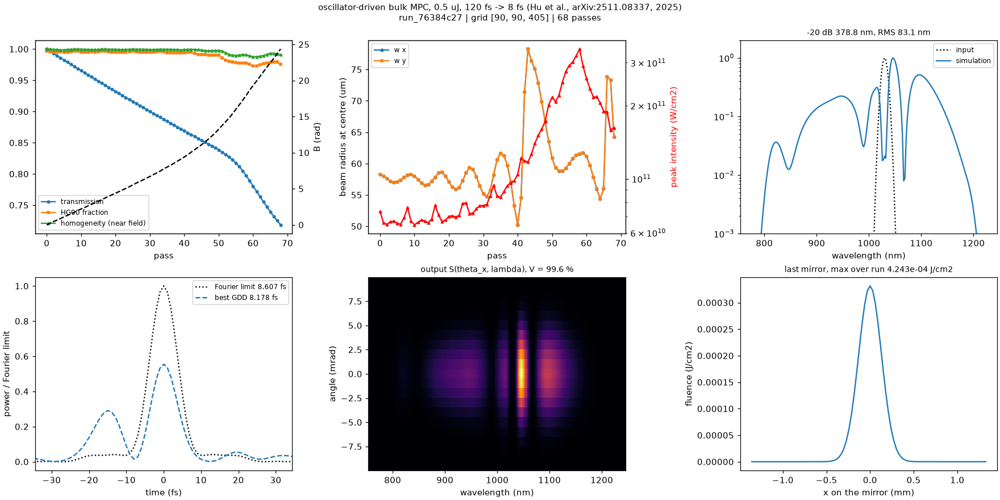
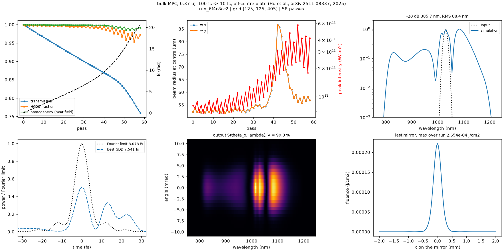
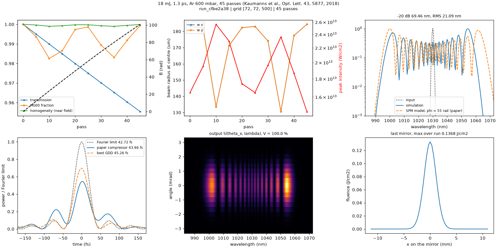
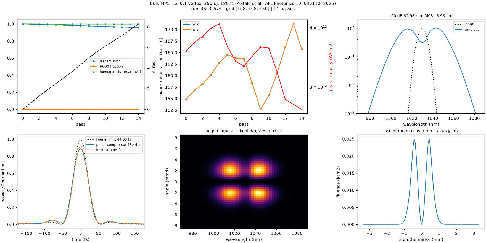
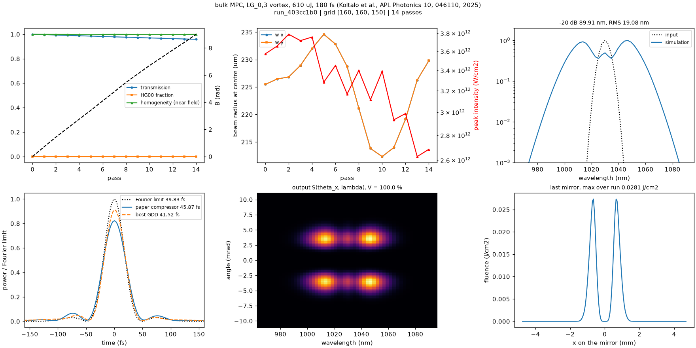
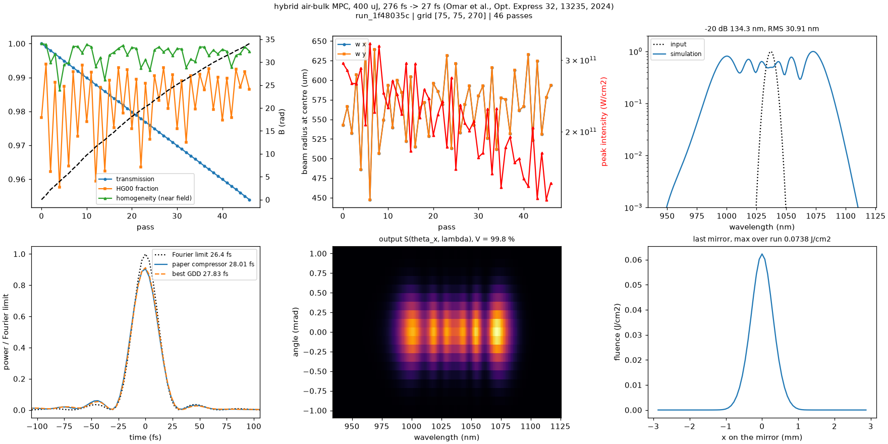
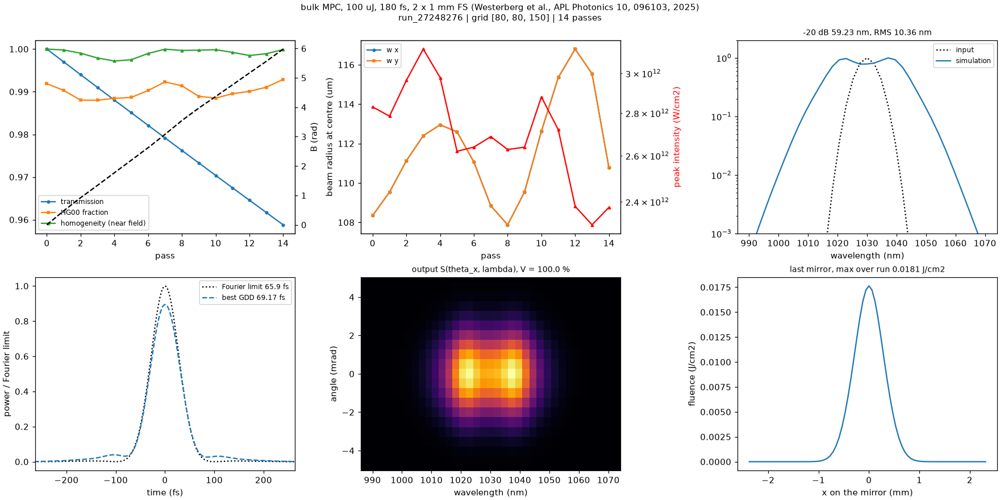
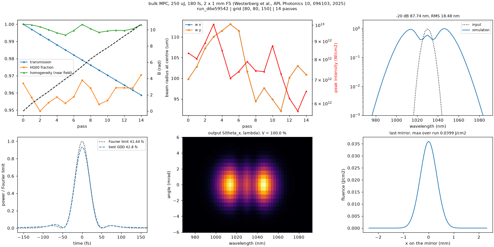

# Benchmark report

Generated by `python analyze.py --report` on 2026-11-17 from the reference runs in `benchmark/reference/`. Reference values and tolerances are those of the current benchmark scripts. Values are given as *simulation (paper)*; values outside the tolerance are in bold.

| benchmark | grid | time | checks ok / off | Fourier limit (fs) | compressed (fs) | transmission | M² x | homogeneity |
|---|---|---|---|---|---|---|---|---|
| [grebing2020_1mJ](#grebing2020_1mj) | 72×72×120 | 1 min (cpu) | 11 / 0 | 26.0 (27.0) | 26.9 (31.0) | 0.984 (0.960) | 1.00 (< 1.15) | 1.000 (> 0.987) |
| [hu2025_flint_500nJ](#hu2025_flint_500nj) | 90×90×405 | 9 min (cpu) | 9 / 0 | 8.6 (8.1) | - | 0.718 (0.750) | 1.01 (< 1.20) | 0.996 |
| [hu2025_pharos_370nJ](#hu2025_pharos_370nj) | 125×125×405 | 14 min (cpu) | 6 / 0 | 8.1 (10.3) | - | 0.760 | 1.19 (< 1.20) | 0.990 |
| [kaumanns2018_18mJ](#kaumanns2018_18mj) | 72×72×500 | 16 min (cpu) | 10 / 2 | 39.4 (39.0) | 46.9 (41.0) | 0.955 (0.957) | 1.00 (< 1.17) | 1.000 (> 0.967) |
| [koltalo2025_gaussian_200uJ](#koltalo2025_gaussian_200uj) | 80×80×150 | 1 min (cpu) | 6 / 2 | **47.1 (42.0)** | **49.9 (45.0)** | 0.959 (> 0.900) | 1.01 (< 1.30) | 1.000 |
| [koltalo2025_lg1](#koltalo2025_lg1) | 108×108×150 | 1 min (cpu) | 10 / 0 | 44.0 (42.0) | 48.4 (45.0) | 0.958 (> 0.900) | 2.03 | 1.000 |
| [koltalo2025_lg2](#koltalo2025_lg2) | 135×135×150 | 1 min (cpu) | 10 / 0 | 43.5 (42.0) | 48.3 (45.0) | 0.959 (> 0.900) | 3.02 | 1.000 |
| [koltalo2025_lg3](#koltalo2025_lg3) | 160×160×150 | 3 min (cpu) | 10 / 0 | 39.8 (42.0) | 45.9 (45.0) | 0.959 (> 0.900) | 4.03 | 1.000 |
| [omar2024_400uJ](#omar2024_400uj) | 75×75×270 | 2 min (cpu) | 12 / 0 | 26.4 (25.0) | 28.0 (27.0) | 0.954 (> 0.910) | 1.02 (< 1.30) | 0.998 (> 0.980) |
| [rueda2021_8fs](#rueda2021_8fs) | 120×120×360 | 6 min (cpu) | 4 / 0 | 6.3 (6.2) | 6.9 (8.1) | 0.715 (0.737) | 1.00 | 0.999 |
| [westerberg2025_100uJ](#westerberg2025_100uj) | 80×80×150 | 1 min (cpu) | 4 / 0 | 65.9 | - | 0.959 (> 0.940) | 1.00 | 1.000 |
| [westerberg2025_250uJ](#westerberg2025_250uj) | 80×80×150 | 1 min (cpu) | 8 / 0 | 41.4 (39.0) | - | 0.959 (> 0.940) | 1.01 (< 1.30) | 1.000 |

## grebing2020_1mJ

**1 mJ, 200 fs, Ar 700 mbar, 26 passes (Grebing et al., Opt. Lett. 45, 6250, 2020)**

- Paper: C. Grebing et al., Opt. Lett. 45, 6250 (2020) ([link](https://doi.org/10.1364/OL.408998))
- Run: `run_fc5327fc`, 2026-11-05, thunder4d 1.0.0 (git ae152b3), cpu, grid 72×72×120, phi_max 0.02, 26 passes in 0.8 min

| metric | simulation | paper | deviation | status | description |
|---|---|---|---|---|---|
| `w0_um` | 153.4 um | 150 ±5% | +2 % | ok | linear eigenmode waist (1/e2 radius) (0.30 mm diameter) |
| `w_mirror_um` | 1273 um | 1250 ±5% | +2 % | ok | linear mode on mirror (1/e2 radius) (2.5 mm diameter) |
| `transmission` | 0.9843  | 0.96 ±0.03 | +3 % | ok | cell transmission (cell + compressor in the paper) |
| `B_rad` | 25.57 rad | 13 | +97 % | info | B-integral, on-axis peak (~13 beam-averaged) |
| `edge_fraction` | 6.637e-07  | < 0.001 | -100 % | ok | max fluence fraction outside 70 % of the box (should be ~0) (numerical check) |
| `M2x` | 1.001  | < 1.15 | -13 % | ok | M2 x (spectrally weighted) |
| `M2y` | 1.001  | < 1.15 | -13 % | ok | M2 y (spectrally weighted) |
| `span20_nm` | 136.7 nm | 120 ±15% | +14 % | ok | -20 dB spectral width |
| `ftl_fs` | 26.04 fs | 27 ±10% | -4 % | ok | Fourier limit (integrated spectrum) |
| `comp_fs` | 26.85 fs | 31 ±15% | -13 % | ok | compressed with the paper's -1923 fs2 (autocorrelation) |
| `V_weighted_x` | 0.9999  | > 0.987 | +1 % | ok | homogeneity, intensity weighted in 1/e2 (x) (measured; the ideal cell can only do better) |
| `d_mm` | 1183 mm | 1183 ±0% | -0 % | ok | mirror separation |

## hu2025_flint_500nJ

**oscillator-driven bulk MPC, 0.5 uJ, 120 fs -> 8 fs (Hu et al., arXiv:2511.08337, 2025)**

- Paper: Z. Hu, K. Fritsch, O. Pronin, arXiv:2511.08337 (2025) ([link](https://arxiv.org/abs/2511.08337))
- Run: `run_76384c27`, 2026-11-16, thunder4d 1.3.0 (git e509a99), cpu, grid 90×90×405, phi_max 0.02, 68 passes in 8.9 min
- Calibrated: `mirror_R` = 0.9985 instead of 0.9970 (paper): authors' simulation: 0.3 % per bounce averaged over a flat band; with the 800-1200 nm band edges modelled, the in-band value giving the measured 75 % transmission
- Calibrated: `n2_fs` = 2.600e-20 instead of 2.200e-20 (paper): not quoted in the paper (2.2e-20 = thunder4d table value); 2.2e-20 fits the FLINT Fourier limit (8.3 fs) but gives B 30 % low, 3.0e-20 fits B (28.5 rad) but gives 9.1 fs: 2.6e-20 is the compromise

| metric | simulation | paper | deviation | status | description |
|---|---|---|---|---|---|
| `transmission` | 0.7184  | 0.75 ±0.05 | -4 % | ok | cell transmission (measured 75 %) |
| `B_rad` | 24.35 rad | 27.3 ±25% | -11 % | ok | B-integral, on-axis peak (0.4 rad per pass (paper)) |
| `edge_fraction` | 6.159e-06  | < 0.001 | -99 % | ok | max fluence fraction outside 70 % of the box (should be ~0) (numerical check) |
| `M2x` | 1.011  | < 1.2 | -16 % | ok | M2 x of the simulated field (ideal-mode input: 1 or l+1) (measured M2 1.107) |
| `M2y` | 1.011  | < 1.2 | -16 % | ok | M2 y of the simulated field (ideal-mode input: 1 or l+1) (measured M2 1.107) |
| `ftl_fs` | 8.607 fs | 8.1 ±10% | +6 % | ok | Fourier limit (integrated spectrum) (Fourier limit of the measured spectrum) |
| `P_over_Pc_plate` | 0.8740  | 1 | -13 % | info | input peak power / Pc of the mode in FS (~5 MW, about the critical power of FS) |
| `mirror_spot_dev` | 0.0454  | < 0.1 | -55 % | ok | max deviation of the mirror spot from the matched mode (Kerr-matched mode held over the passes) |
| `B_fraction_plates` | 0.9944  | > 0.99 | +0 % | ok | share of the plates in the total B-integral (air ~4e-3 rad of 27.3) |
| `gdd_tod_comp_fs` | 8.545 fs | < 11.5 | -26 % | ok | compressed with the best GDD + TOD (measured ~10 fs (CaF2 + TOD mirrors); an ideal GDD + TOD compressor does at least as well) |

## hu2025_pharos_370nJ

**bulk MPC, 0.37 uJ, 100 fs -> 10 fs, off-centre plate (Hu et al., arXiv:2511.08337, 2025)**

- Paper: Z. Hu, K. Fritsch, O. Pronin, arXiv:2511.08337 (2025) ([link](https://arxiv.org/abs/2511.08337))
- Run: `run_6f4c8cc2`, 2026-11-17, thunder4d 1.3.0 (git e509a99), cpu, grid 125×125×405, phi_max 0.02, 58 passes in 14.1 min
- Calibrated: `mirror_R` = 0.9985 instead of 0.9970 (paper): authors' simulation: 0.3 % per bounce averaged over a flat band; with the 800-1200 nm band edges modelled, the in-band value giving the measured 75 % transmission
- Calibrated: `n2_fs` = 2.600e-20 instead of 2.200e-20 (paper): not quoted in the paper (2.2e-20 = thunder4d table value); 2.2e-20 fits the FLINT Fourier limit (8.3 fs) but gives B 30 % low, 3.0e-20 fits B (28.5 rad) but gives 9.1 fs: 2.6e-20 is the compromise

| metric | simulation | paper | deviation | status | description |
|---|---|---|---|---|---|
| `B_rad` | 20.64 rad | 20.4 ±25% | +1 % | ok | B-integral, on-axis peak (paper) |
| `edge_fraction` | 1.434e-04  | < 0.001 | -86 % | ok | max fluence fraction outside 70 % of the box (should be ~0) (numerical check) |
| `M2x` | 1.192  | < 1.2 | -1 % | ok | M2 x of the simulated field (ideal-mode input: 1 or l+1) (not measured here; same cell as the FLINT case (1.107)) |
| `ftl_fs` | 8.078 fs | 10.32 | -22 % | info | Fourier limit (integrated spectrum) (D-scan Fourier limit; the simulation gives ~8.4 fs with the same cell and band as the FLINT case (its 8.3 fs matches): the D-scan spectrum or the authors' 0.37 uJ / 100 fs input may differ) |
| `mirror_spot_dev` | 0.0796  | < 0.1 | -20 % | ok | max deviation of the mirror spot from the matched mode (Kerr-matched mode held over the passes) |
| `B_fraction_plates` | 0.9951  | > 0.99 | +1 % | ok | share of the plates in the total B-integral (air negligible) |
| `gdd_tod_comp_fs` | 7.439 fs | < 11.5 | -35 % | ok | compressed with the best GDD + TOD (D-scan 10.0 fs (78.5 % of the FTL peak); an ideal GDD + TOD compressor does at least as well) |

## kaumanns2018_18mJ

**18 mJ, 1.3 ps, Ar 600 mbar, 45 passes (Kaumanns et al., Opt. Lett. 43, 5877, 2018)**

- Paper: M. Kaumanns et al., Opt. Lett. 43, 5877 (2018) ([link](https://doi.org/10.1364/OL.43.005877))
- Run: `run_1167ec30`, 2026-11-05, thunder4d 1.0.0 (git ae152b3), cpu, grid 72×72×500, phi_max 0.02, 45 passes in 15.6 min
- Calibrated: `energy` = 0.0126 instead of 0.0186 (paper): effective energy: ASE / pre- and post-pulses (see paper)

| metric | simulation | paper | deviation | status | description |
|---|---|---|---|---|---|
| `w0_um` | 183.1 um | 185 ±5% | -1 % | ok | linear eigenmode waist (1/e2 radius) (0.37 mm diameter) |
| `w_mirror_um` | 2680 um | 2700 ±5% | -1 % | ok | linear mode on mirror (1/e2 radius) (5.4 mm diameter) |
| `P_over_Pc` | 0.3236  | 0.5 | -35 % | info | input peak power / critical power |
| `transmission` | 0.9552  | 0.957 ±0.02 | -0 % | ok | cell transmission |
| `B_rad` | 107.3 rad | 55 | +95 % | info | B-integral, on-axis peak (55 (fit), 59 +- 6) |
| `edge_fraction` | 4.680e-06  | < 0.001 | -100 % | ok | max fluence fraction outside 70 % of the box (should be ~0) (numerical check) |
| `M2x` | 1.002  | < 1.17 | -14 % | ok | M2 x (spectrally weighted) |
| `M2y` | 1.002  | < 1.18 | -15 % | ok | M2 y (spectrally weighted) |
| `ftl_fs` | 39.35 fs | 39 ±10% | +1 % | ok | Fourier limit (integrated spectrum) |
| `comp_fs` | 46.92 fs | 41 ±15% | +14 % | ok | compressed with the paper's -9400 fs2 (model 41.6) |
| `comp_peak_ratio` | 0.3082  | 0.62 ±0.1 | -50 % | **off** | peak power / Fourier limit (paper GDD) (model 0.67) |
| `best_gdd_fs2` | -8021 fs2 | -9400 ±15% | +15 % | ok | GDD maximising the peak power |
| `V_weighted_x` | 0.9999  | > 0.967 | +3 % | ok | homogeneity, intensity weighted in 1/e2 (x) (measured; the ideal cell can only do better) |
| `similarity_spm_model` | 0.7634  | 1 ±0.05 | -24 % | **off** | spectral similarity with the paper's SPM model (phi = 55) |

## koltalo2025_gaussian_200uJ

**bulk MPC, gaussian beam, 200 uJ, 180 fs (Koltalo et al., APL Photonics 10, 046110, 2025)**

- Paper: V. Koltalo et al., APL Photonics 10, 046110 (2025) ([link](https://doi.org/10.1063/5.0253348))
- Run: `run_58a3c2bc`, 2026-11-12, thunder4d 1.3.0 (git e70090f), cpu, grid 80×80×150, phi_max 0.02, 14 passes in 0.7 min

| metric | simulation | paper | deviation | status | description |
|---|---|---|---|---|---|
| `transmission` | 0.9587  | > 0.9 | +7 % | ok | cell transmission (MPC transmission > 90 %) |
| `edge_fraction` | 1.376e-05  | < 0.001 | -99 % | ok | max fluence fraction outside 70 % of the box (should be ~0) (numerical check) |
| `M2x` | 1.005  | < 1.3 | -23 % | ok | M2 x (spectrally weighted) (good beam quality (not quantified for this cell in the paper)) |
| `M2y` | 1.005  | < 1.3 | -23 % | ok | M2 y (spectrally weighted) |
| `ftl_fs` | 47.1 fs | 42 ±10% | +12 % | **off** | Fourier limit (integrated spectrum) (FTL around 42 fs) |
| `comp_fs` | 49.93 fs | 45 ±10% | +11 % | **off** | compressed with the paper's -2400 fs2 (SHG-FROG 42-47 fs (TOD side pulse)) |
| `P_over_Pc_plate` | 216.9  | 192 | +13 % | info | input peak power / Pc of the mode in FS (Table 2 input peak power 0.8 GW / 4.16 MW) |
| `mirror_spot_dev` | 0.0167  | < 0.05 | -67 % | ok | max deviation of the mirror spot from the matched mode (Kerr-matched mode held over the passes) |
| `comp_peak_power_GW` | 3.438 GW | 3.1 ±25% | +11 % | ok | compressed peak power, -2400 fs2 (Table 2, after the compressor (losses, TOD)) |

## koltalo2025_lg1

**bulk MPC, LG_0,1 vortex, 350 uJ, 180 fs (Koltalo et al., APL Photonics 10, 046110, 2025)**

- Paper: V. Koltalo et al., APL Photonics 10, 046110 (2025) ([link](https://doi.org/10.1063/5.0253348))
- Run: `run_36e3c576`, 2026-11-12, thunder4d 1.3.0 (git e70090f), cpu, grid 108×108×150, phi_max 0.02, 14 passes in 1.0 min

| metric | simulation | paper | deviation | status | description |
|---|---|---|---|---|---|
| `transmission` | 0.9585  | > 0.9 | +6 % | ok | cell transmission (MPC transmission > 90 %) |
| `edge_fraction` | 2.719e-04  | < 0.001 | -73 % | ok | max fluence fraction outside 70 % of the box (should be ~0) (numerical check) |
| `ftl_fs` | 44.03 fs | 42 ±10% | +5 % | ok | Fourier limit (integrated spectrum) (FTL around 42 fs for all orders) |
| `comp_fs` | 48.44 fs | 45 ±10% | +8 % | ok | compressed with the paper's -2400 fs2 (SHG-FROG 42-47 fs (TOD side pulse)) |
| `P_over_Pc_plate` | 94.89  | 90 | +5 % | info | input peak power / Pc of the mode in FS (Table 2 input peak power / Pc of LG_0,1 in FS) |
| `mirror_spot_dev` | 0.0153  | < 0.05 | -69 % | ok | max deviation of the mirror spot from the matched mode (Kerr-matched mode held over the passes) |
| `comp_peak_power_GW` | 6.151 GW | 5.3 ±25% | +16 % | ok | compressed peak power, -2400 fs2 (Table 2, after the compressor (losses, TOD)) |
| `charge_fraction` | 1.0000  | > 0.9 | +11 % | ok | energy fraction with topological charge l = 1 (output) (topological charge conserved) |
| `oam_change` | -1.082e-07  | 0 ±0.02 |  | ok | change of the mean OAM through the cell (charge conserved) |
| `IH_out` | 3.512e-05  | < 0.16 | -100 % | ok | ring intensity homogeneity, collimated output (0 = ideal) (measured (SLM hot spots): the ideal beam can only do better) |
| `WH_out` | 3.236e-05  | < 0.13 | -100 % | ok | ring width homogeneity, collimated output (0 = ideal) (measured: the ideal beam can only do better) |

## koltalo2025_lg2

**bulk MPC, LG_0,2 vortex, 451 uJ, 180 fs (Koltalo et al., APL Photonics 10, 046110, 2025)**

- Paper: V. Koltalo et al., APL Photonics 10, 046110 (2025) ([link](https://doi.org/10.1063/5.0253348))
- Run: `run_2b344e0d`, 2026-11-12, thunder4d 1.3.0 (git e70090f), cpu, grid 135×135×150, phi_max 0.02, 14 passes in 1.4 min

| metric | simulation | paper | deviation | status | description |
|---|---|---|---|---|---|
| `transmission` | 0.9588  | > 0.9 | +7 % | ok | cell transmission (MPC transmission > 90 %) |
| `edge_fraction` | 2.018e-05  | < 0.001 | -98 % | ok | max fluence fraction outside 70 % of the box (should be ~0) (numerical check) |
| `ftl_fs` | 43.49 fs | 42 ±10% | +4 % | ok | Fourier limit (integrated spectrum) (FTL around 42 fs for all orders) |
| `comp_fs` | 48.28 fs | 45 ±10% | +7 % | ok | compressed with the paper's -2400 fs2 (SHG-FROG 42-47 fs (TOD side pulse)) |
| `P_over_Pc_plate` | 61.14  | 57 | +7 % | info | input peak power / Pc of the mode in FS (Table 2 input peak power / Pc of LG_0,2 in FS) |
| `mirror_spot_dev` | 0.0084  | < 0.05 | -83 % | ok | max deviation of the mirror spot from the matched mode (Kerr-matched mode held over the passes) |
| `comp_peak_power_GW` | 7.926 GW | 6.9 ±25% | +15 % | ok | compressed peak power, -2400 fs2 (Table 2, after the compressor (losses, TOD)) |
| `charge_fraction` | 1.0000  | > 0.9 | +11 % | ok | energy fraction with topological charge l = 2 (output) (topological charge conserved) |
| `oam_change` | -4.053e-10  | 0 ±0.02 |  | ok | change of the mean OAM through the cell (charge conserved) |
| `IH_out` | 1.489e-06  | < 0.1 | -100 % | ok | ring intensity homogeneity, collimated output (0 = ideal) (measured (SLM hot spots): the ideal beam can only do better) |
| `WH_out` | 1.189e-06  | < 0.025 | -100 % | ok | ring width homogeneity, collimated output (0 = ideal) (measured: the ideal beam can only do better) |

## koltalo2025_lg3

**bulk MPC, LG_0,3 vortex, 610 uJ, 180 fs (Koltalo et al., APL Photonics 10, 046110, 2025)**

- Paper: V. Koltalo et al., APL Photonics 10, 046110 (2025) ([link](https://doi.org/10.1063/5.0253348))
- Run: `run_403cc1b0`, 2026-11-12, thunder4d 1.3.0 (git e70090f), cpu, grid 160×160×150, phi_max 0.02, 14 passes in 2.6 min

| metric | simulation | paper | deviation | status | description |
|---|---|---|---|---|---|
| `transmission` | 0.9587  | > 0.9 | +7 % | ok | cell transmission (MPC transmission > 90 %) |
| `edge_fraction` | 1.393e-05  | < 0.001 | -99 % | ok | max fluence fraction outside 70 % of the box (should be ~0) (numerical check) |
| `ftl_fs` | 39.83 fs | 42 ±10% | -5 % | ok | Fourier limit (integrated spectrum) (FTL around 42 fs for all orders) |
| `comp_fs` | 45.87 fs | 45 ±10% | +2 % | ok | compressed with the paper's -2400 fs2 (SHG-FROG 42-47 fs (TOD side pulse)) |
| `P_over_Pc_plate` | 51.68  | 47 | +10 % | info | input peak power / Pc of the mode in FS (Table 2 input peak power / Pc of LG_0,3 in FS) |
| `mirror_spot_dev` | 0.0063  | < 0.05 | -87 % | ok | max deviation of the mirror spot from the matched mode (Kerr-matched mode held over the passes) |
| `comp_peak_power_GW` | 11 GW | 9.1 ±25% | +21 % | ok | compressed peak power, -2400 fs2 (Table 2, after the compressor (losses, TOD)) |
| `charge_fraction` | 1.0000  | > 0.9 | +11 % | ok | energy fraction with topological charge l = 3 (output) (topological charge conserved) |
| `oam_change` | -5.365e-11  | 0 ±0.02 |  | ok | change of the mean OAM through the cell (charge conserved) |
| `IH_out` | 2.591e-06  | < 0.12 | -100 % | ok | ring intensity homogeneity, collimated output (0 = ideal) (measured (SLM hot spots): the ideal beam can only do better) |
| `WH_out` | 2.571e-06  | < 0.037 | -100 % | ok | ring width homogeneity, collimated output (0 = ideal) (measured: the ideal beam can only do better) |

## omar2024_400uJ

**hybrid air-bulk MPC, 400 uJ, 276 fs -> 27 fs (Omar et al., Opt. Express 32, 13235, 2024)**

- Paper: A. Omar et al., Opt. Express 32, 13235 (2024) ([link](https://doi.org/10.1364/OE.513732))
- Run: `run_1f48035c`, 2026-11-13, thunder4d 1.3.0 (git e70090f), cpu, grid 75×75×270, phi_max 0.02, 46 passes in 1.8 min
- Calibrated: `n2_air` = 2.400e-23 instead of 8.000e-24 (paper): electronic Kerr of air x 3, standing for the delayed Raman response of the authors' model (not quoted); fitted on their plate / air B split

| metric | simulation | paper | deviation | status | description |
|---|---|---|---|---|---|
| `transmission` | 0.9540  | > 0.91 | +5 % | ok | cell transmission (overall efficiency > 91 %) |
| `B_rad` | 34.06 rad | 33.1 ±20% | +3 % | ok | B-integral, on-axis peak (2 x 16.56 rad: the authors' B uses I_peak / 2 (inferred, see docstring)) |
| `edge_fraction` | 3.308e-04  | < 0.001 | -67 % | ok | max fluence fraction outside 70 % of the box (should be ~0) (numerical check) |
| `M2x` | 1.02  | < 1.3 | -22 % | ok | M2 x of the simulated field (ideal-mode input: 1 or l+1) (measured 1.17 x 1.23 (input 1.14); simulated < 1.05) |
| `M2y` | 1.02  | < 1.3 | -22 % | ok | M2 y of the simulated field (ideal-mode input: 1 or l+1) (measured 1.17 x 1.23) |
| `ftl_fs` | 26.4 fs | 25 ±10% | +6 % | ok | Fourier limit (integrated spectrum) (authors' simulation (HR mirrors); measured spectrum close to it) |
| `comp_fs` | 28.01 fs | 27 ±10% | +4 % | ok | compressed with the paper's -3000 fs2 (SHG-FROG at -3000 fs2) |
| `V_weighted_x` | 0.9980  | > 0.98 | +2 % | ok | homogeneity, intensity weighted in 1/e2 (x) (measured 98.1 % (x), 98.4 % (y)) |
| `P_over_Pc_plate` | 346.3  | 350 | -1 % | info | input peak power / Pc of the mode in FS ('350x higher than the critical power in FS') |
| `mirror_spot_dev` | 0.2412  | 0.25 | -4 % | info | max deviation of the mirror spot from the matched mode (the pulse stretches ~2x in the cell (positive GDD only): matched at the input power, the beam breathes later (the authors also see the caustic change)) |
| `B_fraction_plates` | 0.4113  | 0.356 ±25% | +16 % | ok | share of the plates in the total B-integral (authors' simulation: 5.9 of 16.56 rad in FS) |
| `chirped_out_fwhm_fs` | 602.4 fs | 616 ±15% | -2 % | ok | output pulse FWHM before the compressor (authors' simulation (measured AC FWHM 621 fs)) |
| `comp_peak_power_GW` | 11.81 GW | 10.2 ±20% | +16 % | ok | compressed peak power, -3000 fs2 (measured (their simulation: ~12 GW)) |
| `main_pulse_fraction` | 0.8857  | > 0.78 | +14 % | ok | energy within 2 x FWHM of the compressed peak (-3000 fs2) (measured (FROG); the measured input spectrum (cut at 1042 nm) and mirror phases are not modelled) |

## rueda2021_8fs

**0.29 mJ, 42 fs -> 8 fs, Ar 1500 mbar, 11 passes (Rueda et al., Opt. Express 29, 27004, 2021)**

- Paper: P. Rueda et al., Opt. Express 29, 27004 (2021) ([link](https://doi.org/10.1364/OE.435086))
- Run: `run_38b076de`, 2026-11-05, thunder4d 1.0.0 (git ae152b3), cpu, grid 120×120×360, phi_max 0.02, 11 passes in 6.0 min
- Calibrated: `energy` = 1.450e-04 instead of 2.900e-04 (paper): x 0.5, as in the authors' own simulation (pedestals, wavefront aberrations)

| metric | simulation | paper | deviation | status | description |
|---|---|---|---|---|---|
| `transmission` | 0.7151  | 0.737 | -3 % | info | cell transmission (0.97^10; chamber incl. windows: 0.614) |
| `I_peak_max_Wcm2` | 1.699e+13 W/cm2 | < 1e+14 | -83 % | ok | max peak intensity at the cell centre (Ar ionisation, order of magnitude) |
| `edge_fraction` | 4.328e-08  | < 0.001 | -100 % | ok | max fluence fraction outside 70 % of the box (should be ~0) (numerical check) |
| `similarity_measured` | 0.9513  | - |  | info | spectral similarity with the measurement |
| `ftl_measured_fs` | 6.178 fs | - |  | info | Fourier limit of the measured (digitised) spectrum |
| `ftl_fs` | 6.284 fs | 6.2 ±10% | +1 % | ok | Fourier limit (integrated spectrum) (FTL of the measured spectrum (Fig. 3a); text: 5.0 fs) |
| `fwhm_measured_pulse_fs` | 8.419 fs | - |  | info | FWHM of the measured (digitised) pulse |
| `comp_fs` | 6.852 fs | 8.06 | -15 % | info | compressed, -480 fs2 + 6.92 mm FS (SPIDER, limited by residual TOD) |
| `broadening_1e` | 7.444  | > 6 | +24 % | ok | spectral width at 1/e, output / input (frequency) (> 6-fold at 1/e) |
| `core_energy_fraction` | 0.9893  | 0.85 | +16 % | info | far-field energy within diameter pi x w (1/e2 half width) (measured, focused beam) |

## westerberg2025_100uJ

**bulk MPC, 100 uJ, 180 fs, 2 x 1 mm FS (Westerberg et al., APL Photonics 10, 096103, 2025)**

- Paper: S. Westerberg et al., APL Photonics 10, 096103 (2025) ([link](https://doi.org/10.1063/5.0272968))
- Run: `run_27248276`, 2026-11-12, thunder4d 1.3.0 (git e70090f), cpu, grid 80×80×150, phi_max 0.02, 14 passes in 0.6 min

| metric | simulation | paper | deviation | status | description |
|---|---|---|---|---|---|
| `transmission` | 0.9588  | > 0.94 | +2 % | ok | cell transmission (MPC transmission > 94 %) |
| `edge_fraction` | 1.467e-05  | < 0.001 | -99 % | ok | max fluence fraction outside 70 % of the box (should be ~0) (numerical check) |
| `best_comp_fs` | 69.17 fs | 75 ±15% | -8 % | ok | compressed with the best GDD (SHG-FROG; assumed first point of the 100-225 uJ scan (5 durations quoted for 6 energies)) |
| `mirror_spot_dev` | 0.0089  | < 0.05 | -82 % | ok | max deviation of the mirror spot from the matched mode (Kerr-matched mode held over the passes) |

## westerberg2025_250uJ

**bulk MPC, 250 uJ, 180 fs, 2 x 1 mm FS (Westerberg et al., APL Photonics 10, 096103, 2025)**

- Paper: S. Westerberg et al., APL Photonics 10, 096103 (2025) ([link](https://doi.org/10.1063/5.0272968))
- Run: `run_d6e59542`, 2026-11-12, thunder4d 1.3.0 (git e70090f), cpu, grid 80×80×150, phi_max 0.02, 14 passes in 0.7 min

| metric | simulation | paper | deviation | status | description |
|---|---|---|---|---|---|
| `transmission` | 0.9588  | > 0.94 | +2 % | ok | cell transmission (MPC transmission > 94 %) |
| `edge_fraction` | 2.443e-05  | < 0.001 | -98 % | ok | max fluence fraction outside 70 % of the box (should be ~0) (numerical check) |
| `M2x` | 1.007  | < 1.3 | -23 % | ok | M2 x (spectrally weighted) (measured 1.1 x 1.3) |
| `M2y` | 1.007  | < 1.3 | -23 % | ok | M2 y (spectrally weighted) (measured 1.1 x 1.3) |
| `ftl_fs` | 41.44 fs | 39 ±10% | +6 % | ok | Fourier limit (integrated spectrum) (FTL of the measured spectrum) |
| `best_comp_fs` | 42.8 fs | 42 ±10% | +2 % | ok | compressed with the best GDD (SHG-FROG, grating compressor tuned) |
| `P_over_Pc_plate` | 271.1  | 300 | -10 % | info | input peak power / Pc of the mode in FS ('up to 300 times' Pc of FS) |
| `mirror_spot_dev` | 0.0208  | < 0.05 | -58 % | ok | max deviation of the mirror spot from the matched mode (Kerr-matched mode held over the passes) |
| `peak_power_out_GW` | 4.457 GW | 4.8 ±15% | -7 % | ok | compressed peak power (best GDD) x compressor T = 0.9 (from the FROG and the energy after the compressor (T > 90 %)) |
