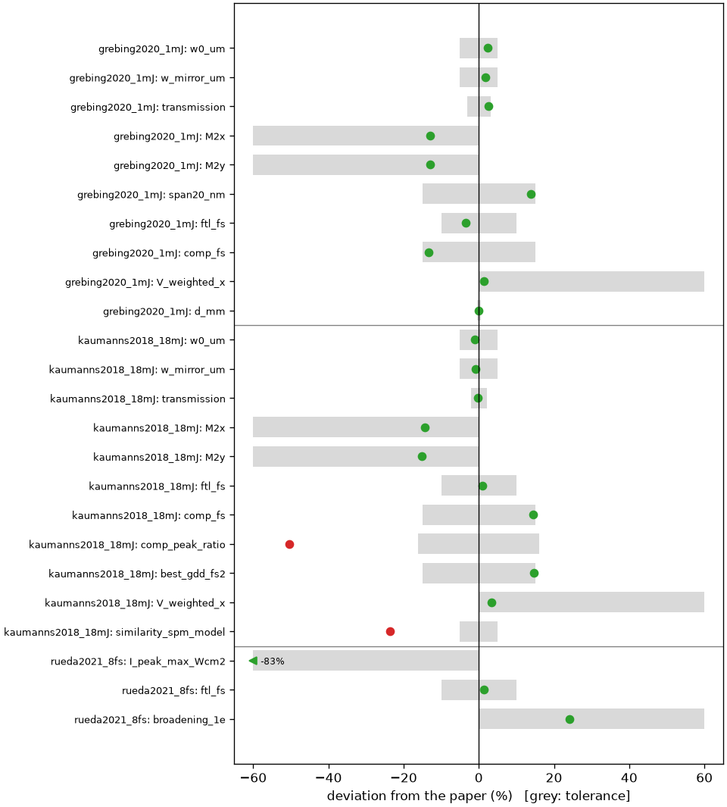
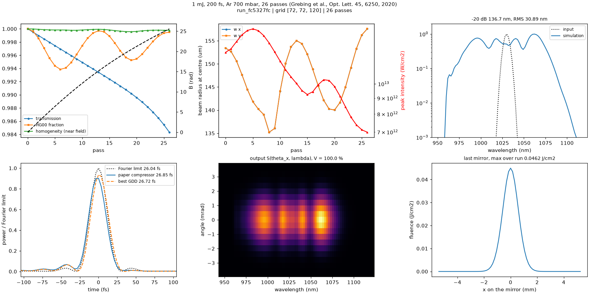
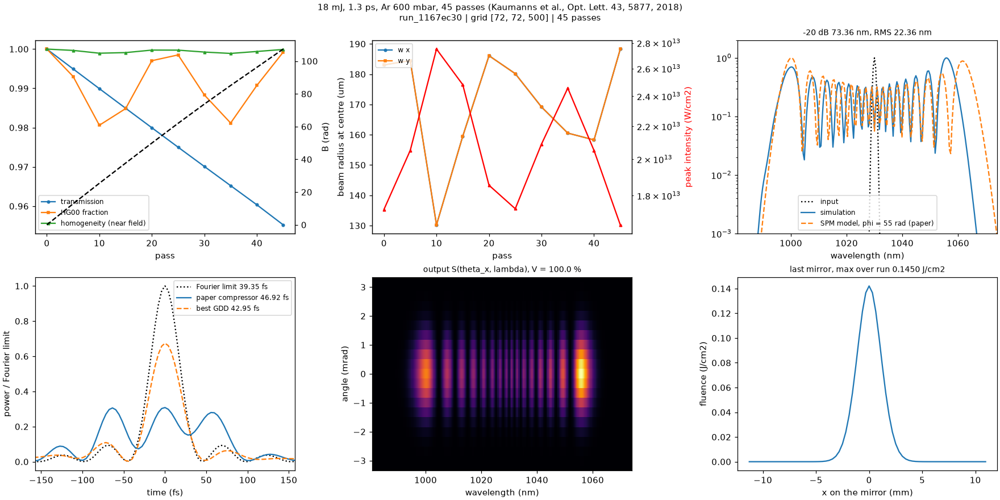
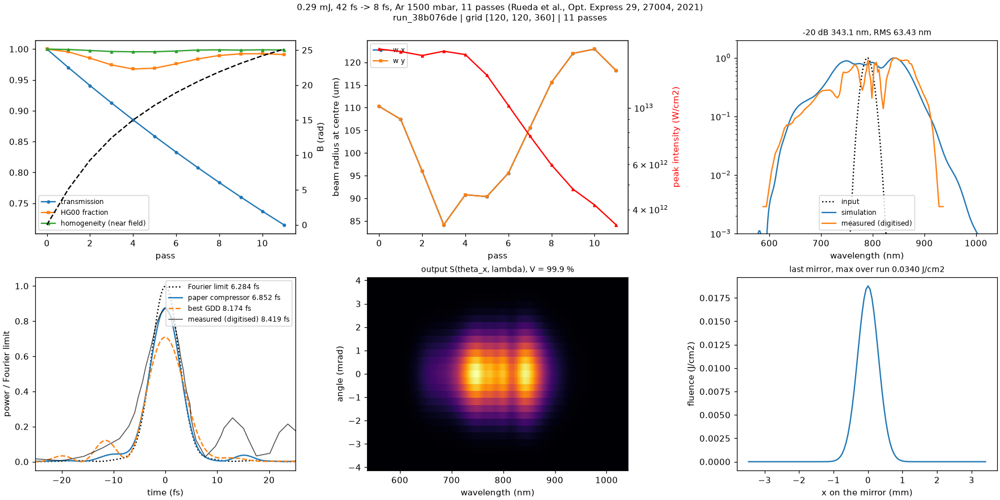

# Benchmark report

Generated by `python analyze.py --report` on 2026-11-05 from the reference runs in `benchmark/reference/`. Reference values and tolerances are those of the current benchmark scripts. Values are given as *simulation (paper)*; values outside the tolerance are in bold.

| benchmark | grid | time | checks ok / off | Fourier limit (fs) | compressed (fs) | transmission | M² x | homogeneity |
|---|---|---|---|---|---|---|---|---|
| [grebing2020_1mJ](#grebing2020_1mj) | 72×72×120 | 1 min (cpu) | 11 / 0 | 26.0 (27.0) | 26.9 (31.0) | 0.984 (0.960) | 1.00 (< 1.15) | 1.000 (> 0.987) |
| [kaumanns2018_18mJ](#kaumanns2018_18mj) | 72×72×500 | 16 min (cpu) | 10 / 2 | 39.4 (39.0) | 46.9 (41.0) | 0.955 (0.957) | 1.00 (< 1.17) | 1.000 (> 0.967) |
| [rueda2021_8fs](#rueda2021_8fs) | 120×120×360 | 6 min (cpu) | 4 / 0 | 6.3 (6.2) | 6.9 (8.1) | 0.715 (0.737) | 1.00 | 0.999 |

## grebing2020_1mJ

**1 mJ, 200 fs, Ar 700 mbar, 26 passes (Grebing et al., Opt. Lett. 45, 6250, 2020)**

- Paper: C. Grebing et al., Opt. Lett. 45, 6250 (2020) ([link](https://doi.org/10.1364/OL.408998))
- Run: `run_fc5327fc`, 2026-11-05, thunder4d 1.0.0 (git ae152b3), cpu, grid 72×72×120, phi_max 0.02, 26 passes in 0.8 min

| metric | simulation | paper | deviation | status | description |
|---|---|---|---|---|---|
| `w0_um` | 153.4 um | 150 ±5% | +2 % | ok | linear eigenmode waist (1/e2 radius) (0.30 mm diameter) |
| `w_mirror_um` | 1273 um | 1250 ±5% | +2 % | ok | linear mode on mirror (1/e2 radius) (2.5 mm diameter) |
| `transmission` | 0.9843  | 0.96 ±0.03 | +3 % | ok | cell transmission (cell + compressor in the paper) |
| `B_rad` | 25.57 rad | 13 | +97 % | info | B-integral, on-axis peak (~13 beam-averaged) |
| `edge_fraction` | 6.637e-07  | < 0.001 | -100 % | ok | max fluence fraction outside 70 % of the box (should be ~0) (numerical check) |
| `M2x` | 1.001  | < 1.15 | -13 % | ok | M2 x (spectrally weighted) |
| `M2y` | 1.001  | < 1.15 | -13 % | ok | M2 y (spectrally weighted) |
| `span20_nm` | 136.7 nm | 120 ±15% | +14 % | ok | -20 dB spectral width |
| `ftl_fs` | 26.04 fs | 27 ±10% | -4 % | ok | Fourier limit (integrated spectrum) |
| `comp_fs` | 26.85 fs | 31 ±15% | -13 % | ok | compressed with the paper's -1923 fs2 (autocorrelation) |
| `V_weighted_x` | 0.9999  | > 0.987 | +1 % | ok | homogeneity, intensity weighted in 1/e2 (x) (measured; the ideal cell can only do better) |
| `d_mm` | 1183 mm | 1183 ±0% | -0 % | ok | mirror separation |

## kaumanns2018_18mJ

**18 mJ, 1.3 ps, Ar 600 mbar, 45 passes (Kaumanns et al., Opt. Lett. 43, 5877, 2018)**

- Paper: M. Kaumanns et al., Opt. Lett. 43, 5877 (2018) ([link](https://doi.org/10.1364/OL.43.005877))
- Run: `run_1167ec30`, 2026-11-05, thunder4d 1.0.0 (git ae152b3), cpu, grid 72×72×500, phi_max 0.02, 45 passes in 15.6 min
- Calibrated: `energy` = 0.0126 instead of 0.0186 (paper): effective energy: ASE / pre- and post-pulses (see paper)

| metric | simulation | paper | deviation | status | description |
|---|---|---|---|---|---|
| `w0_um` | 183.1 um | 185 ±5% | -1 % | ok | linear eigenmode waist (1/e2 radius) (0.37 mm diameter) |
| `w_mirror_um` | 2680 um | 2700 ±5% | -1 % | ok | linear mode on mirror (1/e2 radius) (5.4 mm diameter) |
| `P_over_Pc` | 0.3236  | 0.5 | -35 % | info | input peak power / critical power |
| `transmission` | 0.9552  | 0.957 ±0.02 | -0 % | ok | cell transmission |
| `B_rad` | 107.3 rad | 55 | +95 % | info | B-integral, on-axis peak (55 (fit), 59 +- 6) |
| `edge_fraction` | 4.680e-06  | < 0.001 | -100 % | ok | max fluence fraction outside 70 % of the box (should be ~0) (numerical check) |
| `M2x` | 1.002  | < 1.17 | -14 % | ok | M2 x (spectrally weighted) |
| `M2y` | 1.002  | < 1.18 | -15 % | ok | M2 y (spectrally weighted) |
| `ftl_fs` | 39.35 fs | 39 ±10% | +1 % | ok | Fourier limit (integrated spectrum) |
| `comp_fs` | 46.92 fs | 41 ±15% | +14 % | ok | compressed with the paper's -9400 fs2 (model 41.6) |
| `comp_peak_ratio` | 0.3082  | 0.62 ±0.1 | -50 % | **off** | peak power / Fourier limit (paper GDD) (model 0.67) |
| `best_gdd_fs2` | -8021 fs2 | -9400 ±15% | +15 % | ok | GDD maximising the peak power |
| `V_weighted_x` | 0.9999  | > 0.967 | +3 % | ok | homogeneity, intensity weighted in 1/e2 (x) (measured; the ideal cell can only do better) |
| `similarity_spm_model` | 0.7634  | 1 ±0.05 | -24 % | **off** | spectral similarity with the paper's SPM model (phi = 55) |

## rueda2021_8fs

**0.29 mJ, 42 fs -> 8 fs, Ar 1500 mbar, 11 passes (Rueda et al., Opt. Express 29, 27004, 2021)**

- Paper: P. Rueda et al., Opt. Express 29, 27004 (2021) ([link](https://doi.org/10.1364/OE.435086))
- Run: `run_38b076de`, 2026-11-05, thunder4d 1.0.0 (git ae152b3), cpu, grid 120×120×360, phi_max 0.02, 11 passes in 6.0 min
- Calibrated: `energy` = 1.450e-04 instead of 2.900e-04 (paper): x 0.5, as in the authors' own simulation (pedestals, wavefront aberrations)

| metric | simulation | paper | deviation | status | description |
|---|---|---|---|---|---|
| `transmission` | 0.7151  | 0.737 | -3 % | info | cell transmission (0.97^10; chamber incl. windows: 0.614) |
| `I_peak_max_Wcm2` | 1.699e+13 W/cm2 | < 1e+14 | -83 % | ok | max peak intensity at the cell centre (Ar ionisation, order of magnitude) |
| `edge_fraction` | 4.328e-08  | < 0.001 | -100 % | ok | max fluence fraction outside 70 % of the box (should be ~0) (numerical check) |
| `similarity_measured` | 0.9513  | - |  | info | spectral similarity with the measurement |
| `ftl_measured_fs` | 6.178 fs | - |  | info | Fourier limit of the measured (digitised) spectrum |
| `ftl_fs` | 6.284 fs | 6.2 ±10% | +1 % | ok | Fourier limit (integrated spectrum) (FTL of the measured spectrum (Fig. 3a); text: 5.0 fs) |
| `fwhm_measured_pulse_fs` | 8.419 fs | - |  | info | FWHM of the measured (digitised) pulse |
| `comp_fs` | 6.852 fs | 8.06 | -15 % | info | compressed, -480 fs2 + 6.92 mm FS (SPIDER, limited by residual TOD) |
| `broadening_1e` | 7.444  | > 6 | +24 % | ok | spectral width at 1/e, output / input (frequency) (> 6-fold at 1/e) |
| `core_energy_fraction` | 0.9893  | 0.85 | +16 % | info | far-field energy within diameter pi x w (1/e2 half width) (measured, focused beam) |
