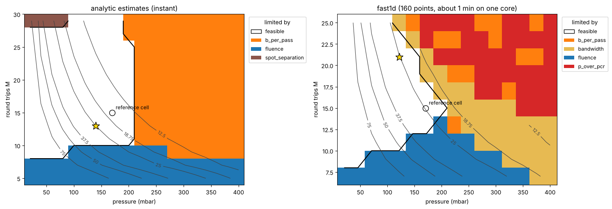

Design-space maps
=================

A search returns a few designs. A **map** shows the whole neighbourhood: for two parameters it tells,
at every point, whether a cell is feasible and, if not, **which constraint excludes it**. It is the
fastest way to understand what limits a design and which limit is worth relaxing.

.. code-block:: python

   from thunder4d.design import Fast1DQuick, design_map

   # pressure x round trips, analytic estimates
   m = design_map(problem, gas="Ar", roc_m=2.0, k=2)
   m.plot(mark=[(0.17, 15, "reference cell")])
   print(m.summary())

   # the same with fast1d, in 8 processes
   m = design_map(problem, gas="Ar", roc_m=2.0, k=2, quick=Fast1DQuick(), workers=8)

   Map of the 18 mJ, 500 fs case of :doc:`design`, argon, :math:`R = 2` m, :math:`k = 2`, calibrated
   limits. Left: analytic estimates (0.3 s). Right: fast1d (160 points, about one minute on one core).
   The white region is feasible and the black line outlines it; the grey lines are contours of the
   compressed duration (fs), the star is the best feasible point and the circle a cell of your
   choice. Each colour is the constraint that excludes the region.

What the colours mean
---------------------

At every point the cell is evaluated exactly as in the search (same limits, same score). Its colour
is the **most violated hard limit**; if no hard limit is violated the point is *feasible*. A point
where only the ``simulation`` limit fails (the quick solver stopped on a shock or a collapse) is
labelled by it only if no physical limit is crossed. A colour is the same constraint on every map.

On the figure, the two solvers draw the same picture of the low-pressure and low-:math:`M` regions
(fluence on the mirrors excludes the smallest cells, the duration contours agree) and differ where
the analytic estimates cannot see: with fast1d, the high-pressure side is limited by
:math:`P/P_c`, by the bandwidth of the coating (the spectrum has broadened beyond it) and by B per
pass, and the feasible region ends earlier at large :math:`M`. Use the analytic map to explore, and the fast1d map to
decide.

Axes
----

.. code-block:: python

   design_map(problem, *, gas, roc_m, k=1, round_trips=None, branch="concentric",
              x=None, y=None, quick=None, coating=None, diameter_inch=None,
              pass_offset=0, workers=None)

Everything not scanned is fixed by the arguments: the gas, the radius, the branch, the coating
(default: the first allowed one), the mirror diameter and, unless it is a scanned axis, the number of
round trips ``round_trips``. The axes are ``(name, values)`` pairs,
with the default :math:`x` = pressure (41 points from the pressure range of the constraints) and
:math:`y` = round trips (the range of ``problem.search.round_trips``).

.. list-table::
   :header-rows: 1
   :widths: 24 76

   * - Axis name
     - Meaning
   * - ``"pressure_bar"``
     - pressure
   * - ``"round_trips"``
     - number of round trips :math:`M` (passes are :math:`2M` + ``pass_offset``)
   * - ``"n_passes"``
     - number of passes at a fixed geometry (:math:`M`, :math:`k`), at most :math:`2M`
   * - ``"roc_m"``
     - radius of curvature
   * - ``"k"``
     - Herriott index
   * - ``"energy_J"``, ``"duration_fs"``
     - laser parameters (the problem is copied for each value)

``k`` may be a fixed index or ``"smallest"`` (the smallest valid index for each :math:`M`). Points that
are not a re-entrant geometry (for example even :math:`M` with :math:`k = 2`) are dropped, and so are
the rows and columns without any valid point.

.. code-block:: python

   import numpy as np

   # how much energy can a given cell take? (round_trips is fixed, so it is given)
   design_map(problem, gas="Ar", roc_m=2.0, k=2, round_trips=15,
              x=("energy_J", np.linspace(5e-3, 30e-3, 12)),
              y=("pressure_bar", np.linspace(0.05, 0.3, 12))).plot()

The result
----------

:class:`~thunder4d.design.scan.DesignMap` keeps everything, to plot or to analyse:

.. list-table::
   :header-rows: 1
   :widths: 24 76

   * - Attribute
     - Content
   * - ``x``, ``y``, ``x_name``, ``y_name``
     - the axes
   * - ``limiting``
     - array of strings, the limiting constraint or ``"feasible"``
   * - ``tightest``, ``margin``
     - the limit with the smallest margin at each point (also for feasible points), and that margin
   * - ``values``
     - dictionary of arrays: ``duration_fs``, ``throughput``, ``b_total_rad``, ``b_per_pass_rad``,
       ``p_over_pcr``, ``peak_intensity_W_cm2``, ``separation_m``, ``score``
   * - ``candidates``
     - the evaluated :class:`~thunder4d.design.designer.Candidate` at each point, with its report
   * - ``feasible``, ``best()``, ``summary()``
     - mask of the feasible points, the best feasible candidate, a one-paragraph description

``m.plot(ax=None, contour="duration_fs", levels=None, mark=(), show_best=True)`` draws the map on
the axes you give; ``contour`` can be any key of ``values``. The tutorial notebook shows both
solvers next to each other.

Cost
----

The analytic solver takes a fraction of a second for a thousand points. With fast1d expect a few tenths of a
second per point on one core (the cells with the largest B-integral cost the most); ``workers`` splits the
points over processes. Keep a fast1d map to a few hundred points, or restrict the axes to the region
the analytic map has shown to be interesting.
