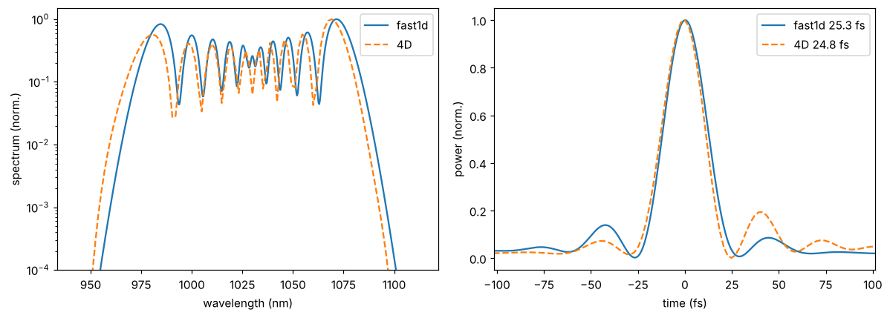

From a design to a full simulation
==================================

A design is a prediction of fast1d. The step that makes it a result is to run it with the 4D solver.
Two tools do it: the export of the design as a **standard THUNDER4D input file**, and
``validate_4d``, which runs it and compares it with fast1d.

The input file
--------------

A design becomes a file in one line, from the result or from any design:

.. code-block:: python

   result.export("design.json")                       # the best design of a result
   result.export("second.json", which=1)              # the second one

   from thunder4d.design import export_input, to_input
   cfg = to_input(problem, candidate, preset="medium")   # the same, as a dictionary
   export_input(problem, candidate, "design.json", preset="medium")

and a file runs in one line, with nothing from the design helper:

.. code-block:: python

   import thunder4d as th

   b = th.run_input("design.json")        # b.sim: the finished LensFrameSimulation
   cfg = th.load_input("design.json")     # a checked dictionary, defaults filled in

The format is documented in :doc:`../api_reference/inputfile`. The file of a design is
self-contained (the mirror curves of the coating are written inline) and records where it comes from
in its free-form ``design`` block: the candidate, the predictions of fast1d, the margin to every
limit, the warnings and the laser and target of the problem. It is meant to be edited: change the
grid, the injection or the solver settings, and run it again.

``to_input`` and ``export_input`` take the settings that the design helper cannot know:

.. list-table::
   :header-rows: 1
   :widths: 24 18 58

   * - Argument
     - Default
     - Meaning
   * - ``preset``
     - ``"coarse"``
     - grid resolution: ``"coarse"``, ``"medium"``, ``"fine"`` (see below)
   * - ``injection``
     - ``"linear"``
     - ``"linear"`` (linear eigenmode), ``"nonlinear"`` (Kerr-matched waist) or ``"waist"``
   * - ``window``
     - None
     - spectral window of the grid ``(lambda_min_nm, lambda_max_nm)``; ``None``: the predicted
       output spectrum down to :math:`10^{-4}`, widened by 15 % on each side
   * - ``precision``, ``device``
     - ``"single"``, ``"auto"``
     - arithmetic precision, and ``"cpu"`` / ``"gpu"``
   * - ``run``
     - None
     - overrides of the ``run`` block (``record_every``, ``near_field``, ``record_mirror``)

Grid presets
~~~~~~~~~~~~

The lens-frame grid is chosen by :func:`~thunder4d.lensframe.suggest_lens_grid` from three numbers:

.. list-table::
   :header-rows: 1
   :widths: 14 14 22 22 28

   * - Preset
     - Box (waists)
     - Points per waist
     - Time window (pulses)
     - Use
   * - ``"coarse"``
     - 5
     - 3
     - 4
     - the validation of a design: seconds to minutes
   * - ``"medium"``
     - 6
     - 6
     - 6
     - a check of the coarse result
   * - ``"fine"``
     - 8
     - 8
     - 8
     - benchmark grade

Any of the three numbers can be overridden in the ``grid`` block of the file.

Validating a design
-------------------

.. code-block:: python

   from thunder4d.design import validate_4d

   v = validate_4d(problem, result.best)               # coarse grid, all the passes
   print(v.summary())
   v.plot()

``validate_4d`` runs fast1d (``"default"`` accuracy) and the 4D solver on the same cell, with the same
pulse and the same mirrors, and compares what both can say. The 4D compression is analysed on a time
axis oversampled eight times, because a coarse grid holds a few-cycle pulse with only a few samples.
On the reference cell of :doc:`design` (argon, 170 mbar, :math:`R = 2` m, 15 round trips, :math:`k = 2`,
29 passes), on the coarse grid:

.. code-block:: text

   4D validation of Ar_170mbar_R2_M15k2 (coarse grid 18x18x125, 29 passes, 9 s)
     quantity                        fast1d          4D     diff
     transmission                    0.9856      0.9757    -1.0%
     B-integral [rad]                 63.23       67.95    +7.5%
     FTL duration [fs]                   25       24.14    -3.4%
     compressed duration [fs]         25.34       24.79    -2.2%
     compressor GDD [fs^2]            -2118       -1930    +8.9%
     compressed peak [GW]             435.3         403    -7.4%
     mirror fluence [J/cm2]          0.5587      0.5139    -8.0%
     spectrum (L1 distance)               0      0.2294
     M2 (x, mean)                                 1.002
     M2 (y, mean)                                 1.002
     HG00 fraction                               0.9972
     peak / FTL peak (4D)                        0.7367

   fast1d and the 4D solver on that cell: output spectrum (left) and compressed pulse (right), the
   latter centred.

How to read it
~~~~~~~~~~~~~~

- The **durations and the transmission** agree within a few percent: what the helper is made for,
  the cell reaches the target.
- The **B-integral is 7.5 % higher** in 4D, and the compressed peak power and the mirror fluence are
  lower: at :math:`P/P_c = 0.34` the beam is not a perfect Gaussian, which fast1d assumes (see
  :doc:`solvers`). The spectra have the same structure, the 4D one being shifted by a few nm towards
  short wavelengths.
- ``M2``, ``HG00 fraction`` and the ratio of the compressed peak to the Fourier-limit peak are 4D
  results with no counterpart in fast1d: here the beam stays clean (:math:`M^2 = 1.002`, HG\ :sub:`00`
  fraction 0.997).
- Do not read the differences as errors of the 4D solver: it contains more physics. If a difference
  matters for a decision (a margin of a few percent on the fluence, say), use the 4D numbers and
  adjust the limits.

On this cell the coarse and medium grids agree within 1 % on the durations, the B-integral, the
GDD and the peak power. The mirror fluence, which the coarse grid samples with few points, moves by
3 %. The coarse grid is enough to validate a design; use ``preset="medium"`` or ``"fine"`` if a
quantity you rely on, the mirror fluence in particular, matters at the percent level.

Time
~~~~

The 4D run costs, on one core of an ordinary computer:

.. list-table::
   :header-rows: 1
   :widths: 40 20 20 20

   * - Cell
     - ``"coarse"``
     - ``"medium"``
     - Grid (coarse)
   * - 2 mJ, 190 fs, 20 passes, B = 14 rad
     - 1 s
     - 8 s
     - 18 x 18 x 45
   * - 18 mJ, 500 fs, 29 passes, B = 63 rad
     - 10-20 s
     - 90 s
     - 18 x 18 x 125

``max_seconds`` stops a run cleanly after the pass that exceeds the budget.

Recommended workflow
--------------------

1. Search with fast1d (``refine`` / ``run``), and keep the three to five best designs.
2. ``Fast1DQuick().validate(problem, design)`` on each: is fast1d converged for it?
3. ``validate_4d(problem, design)`` on each: is the prediction confirmed?
4. For the design you build, export it (``preset="medium"`` or ``"fine"``), edit the file if needed
   (a measured spectrum or spatial profile, the injection) and run it with ``th.run_input``.
