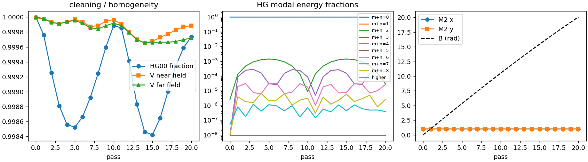
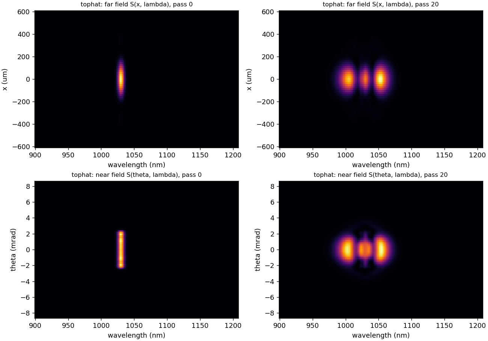
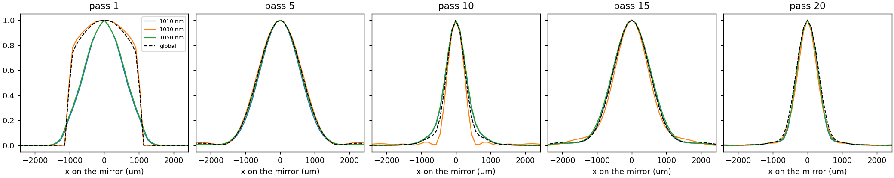
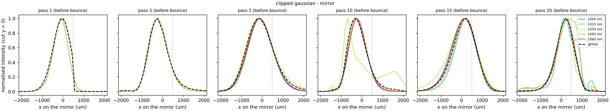
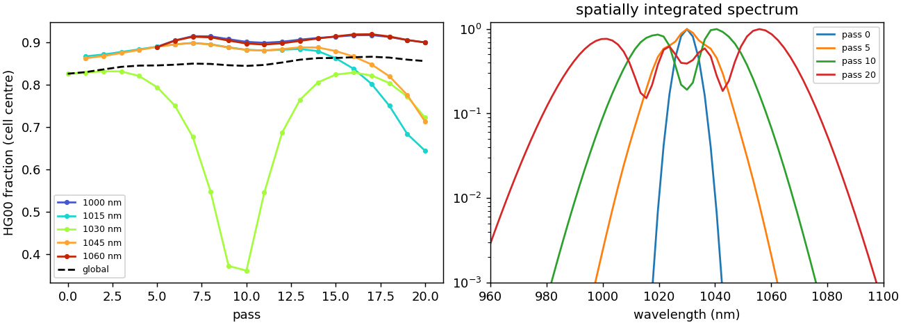

Examples
========

The example scripts in ``examples/`` use the lens-frame solver
(:class:`~thunder4d.lensframe.LensFrameSimulation`, see :doc:`../overview/lens_frame`) and the
same toy cell as the tutorial: argon at 1 bar, near-concentric Herriott cell with
:math:`R = 0.5` m, :math:`N = 20`, :math:`k = 1` (:math:`d = 0.976` m, 20 passes, 162° of Gouy
phase per pass, mirror spot 6.4 times the waist) and 200 fs, 0.6 mJ pulses at 1030 nm
(B ≈ 20 rad). The lens-frame grid is 120 × 120 × 144; each simulation takes about 6 minutes on
one CPU core, much less on a GPU.

Mirror-plane records are in frame coordinates; the scripts convert them to physical positions
and fluences with ``sim.mirror_scale``.

All scripts accept an optional time budget in seconds, write a checkpoint when it is
reached, and resume from it on the next launch:

.. code-block:: bash

   uv run --extra examples python clipped_gauss_profiles.py 600

The interactive introduction is the notebook ``examples/tutorial.ipynb``; comparisons with
published experiments are the scripts of ``benchmark/`` (see :ref:`benchmarks`).

Gaussian versus top-hat
-----------------------

``compare_gauss_tophat.py`` sends a matched Gaussian and a top-hat near field (Fourier
injection) through the same cell. Set ``QUICK = False`` for a template of a real stage.

Outputs (``out_gauss/``, ``out_tophat/``, ``run_*.npz``): spatio-spectral traces
:math:`S(x,\lambda)` and :math:`S(\theta,\lambda)` at input and output; HG₀₀ fraction,
homogeneity, mode orders, :math:`M^2` and B versus pass; :math:`\eta_{00}(\lambda)`;
fluence maps; radial GDD; peak fluence on the mirrors; compression.

   Matched Gaussian: the HG₀₀ fraction stays above 0.998 and the spectral homogeneity
   above 0.9996 up to B ≈ 20 rad.

   Top-hat (Fourier injection): spatio-spectral traces at the cell centre (far field) and in the
   collimated beam (near field), input (left) and output (right).

Wavelength-resolved profiles of a top-hat
-----------------------------------------

``tophat_profiles_vs_pass.py`` records the 1D profiles at 1010, 1030 and 1050 nm and
the global profile at every pass, at the cell centre (far field), at the mirror and in the collimated
beam (near field). ``INJECTION = "mirror"`` images the near field on the first mirror;
``"fourier"`` puts the Airy pattern at the cell centre.

   Top-hat imaged on the mirror: profiles at the mirror plane (physical coordinates). At
   pass 1 the fundamental is the imaged top-hat while the colours generated by self-phase
   modulation are already smooth; the fundamental keeps a structured profile in later passes.

Gaussian with a hard edge
-------------------------

``clipped_gauss_profiles.py`` clips a Gaussian with a knife edge at
:math:`x = +0.5\,w_\text{mirror}` (about 16 % of the beam), images it on the first
mirror, and records 1D profiles (linear and log scale) at 1000–1060 nm at the centre, at
the mirror and in the collimated beam (near field), plus :math:`\eta_{00}` of each colour versus pass.

   Mirror-plane profiles. The edge is visible at pass 1; from pass 5 on, the generated
   colours are smooth Gaussians.

   Left: HG₀₀ fraction of each colour versus pass. Right: spatially integrated
   spectrum.

.. _benchmarks:

Benchmarks against experiments
------------------------------

``benchmark/`` holds one standalone script per published experiment, all built on
``benchmark/framework.py`` so that they run, store and analyse results in the same way:

.. list-table::
   :header-rows: 1
   :widths: 34 40 26

   * - Script
     - Paper
     - Regime
   * - ``bench_grebing2020_1mJ.py``
     - Grebing *et al.*, Opt. Lett. **45**, 6250 (2020)
     - 1 mJ, 200 fs, Ar
   * - ``bench_kaumanns2018_18mJ.py``
     - Kaumanns *et al.*, Opt. Lett. **43**, 5877 (2018)
     - 18 mJ, 1.3 ps, Ar
   * - ``bench_daniault2024_4fs.py``
     - Daniault *et al.*, Opt. Lett. (2024)
     - 6.7 mJ, 35 fs → 4 fs, He

.. code-block:: bash

   cd benchmark
   python bench_grebing2020_1mJ.py --quick              # checks the script (2 passes, coarse grid)
   python bench_grebing2020_1mJ.py --device gpu         # full run
   python bench_daniault2024_4fs.py --set pressure_bar=2.2 --label p2.2
   python analyze.py --latest --plot                    # tables against the papers + figures

Each run writes ``results/<benchmark>/<run_id>/results.json`` (metadata, parameters and about 30
standard metrics, each with the published value, a tolerance and a status) and ``curves.npz``
(standard curves). ``analyze.py`` compares runs (``--compare``), plots parameter sweeps
(``--sweep``) and exports CSV. ``benchmark/README.md`` documents the options, the output format
and how to add a new benchmark.
