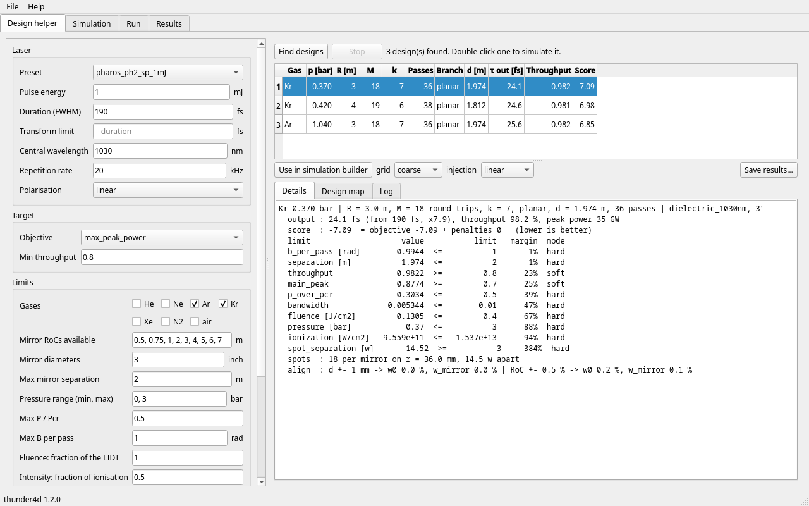
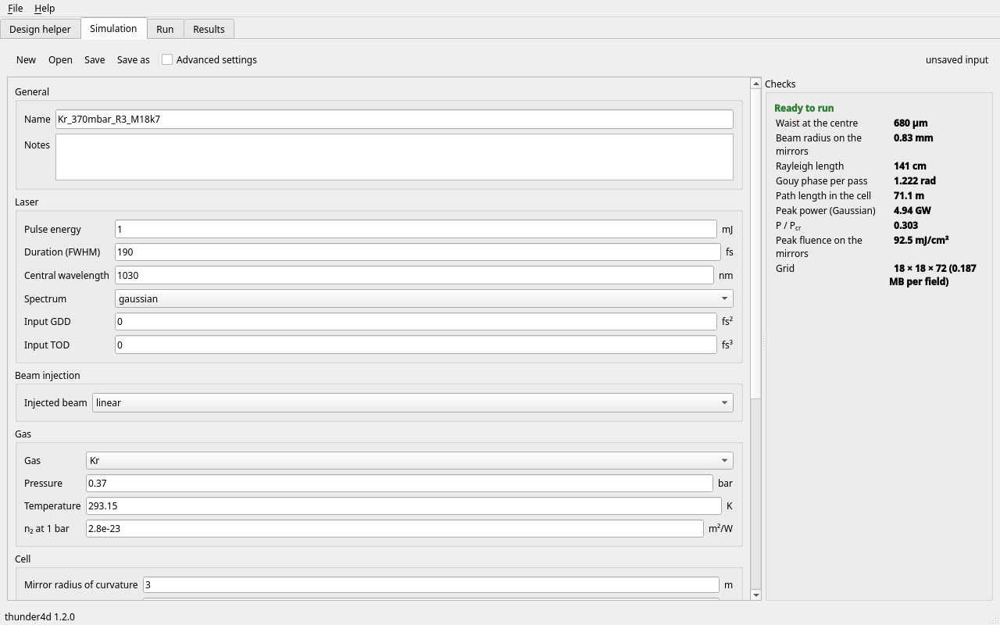
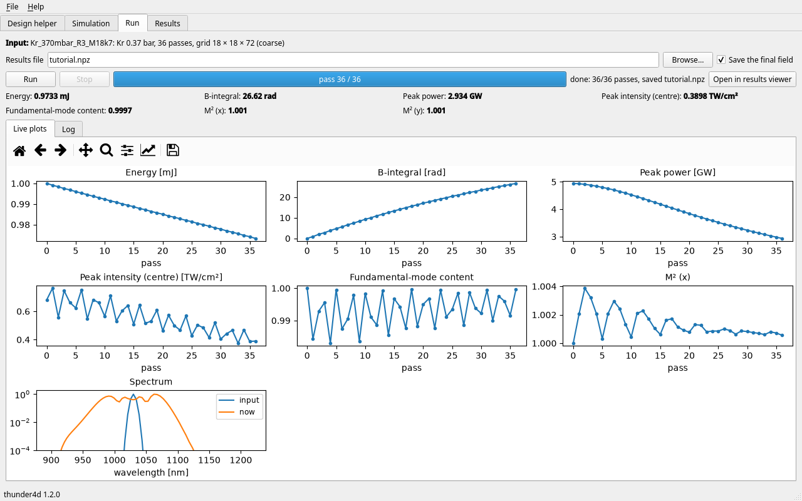
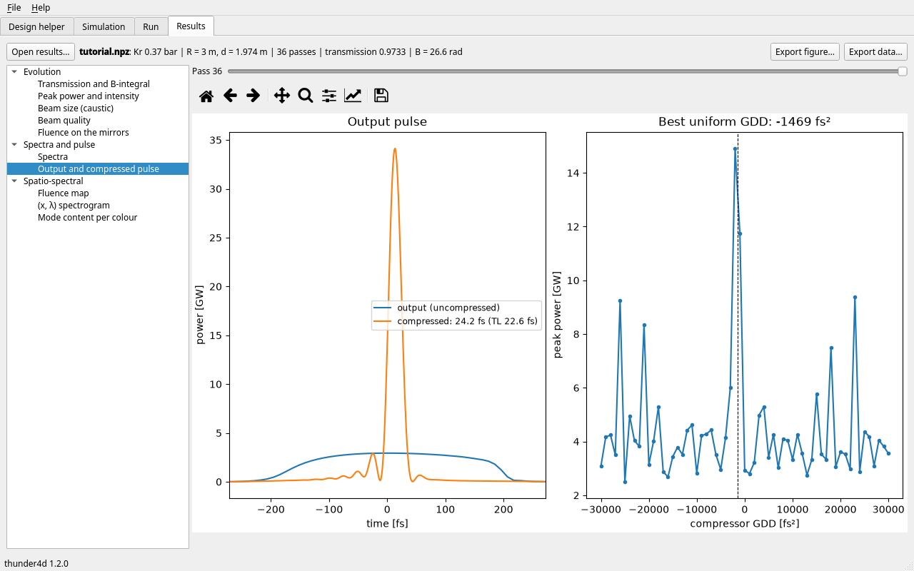

Graphical interface
===================

.. code-block:: bash

   pip install "thunder4d[gui]"
   thunder4d-gui                 # or: thunder4d-gui cell.json

Four tabs, used from left to right. Everything is saved as standard input files (``.json``) and results
(``.npz``), so a session can be rerun or analysed from a script.

Design helper
-------------

Pick a laser preset or enter the laser, set the limits and the search, then **Find designs**. The
search of the :doc:`design helper <user_guide/design>` runs in the background (Fast 1+1D, or analytic
for a first look); **Stop** ends it. *Details* gives the report of the selected design, *Design map*
the pressure × round-trips plane around it. **Use in simulation builder** (or a double click) sends it
to the next tab.

Simulation
----------

Every field of the input file, in readable units, checked while you type: a field at fault is framed in
red and listed under *Checks*. A valid input shows its eigenmode, peak power and :math:`P/P_{cr}`, peak
fluence on the mirrors and grid size. Tables (measured spectrum, mirror curves) are imported from CSV or
pasted from a spreadsheet, first column in nm. *Save* is disabled while the input has problems.

Run
---

Runs the input pass by pass in the background, with the progress, the time left, and the energy,
B-integral, peak power and intensity, mode content and :math:`M^2` after every pass. **Stop** ends the
run after the current pass and still saves it; so does an error.

Results
-------

Opens the run that just finished or any saved ``.npz``. The list holds the figures the run can draw:
evolution versus pass (transmission and B, peak power, beam size at the centre and on the mirrors,
beam quality, mirror fluence), spectra, the output and compressed pulse, fluence maps, :math:`(x,\lambda)`
and :math:`(\theta,\lambda)` spectrograms, mode content per colour. The slider selects the pass.
*Export figure* (PNG, PDF, SVG) and *Export data* (NPZ, or CSV for 1D data).

   Output of the design above: 24.2 fs, as predicted by the design helper (24.1 fs).

The screenshots are made by ``docs/gui_screenshots.py``. To add a field, a figure or a tool to the
interface, see :doc:`development`.
