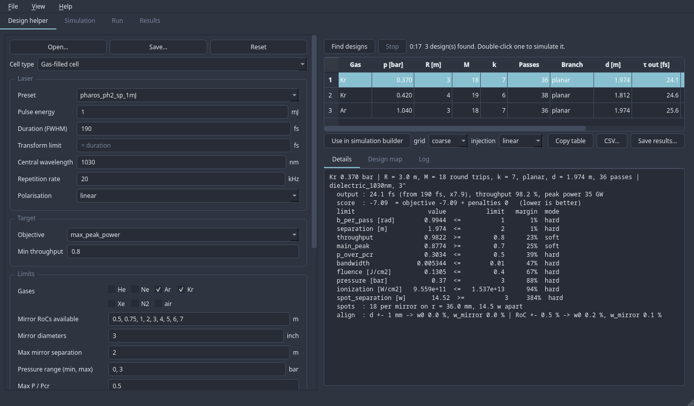
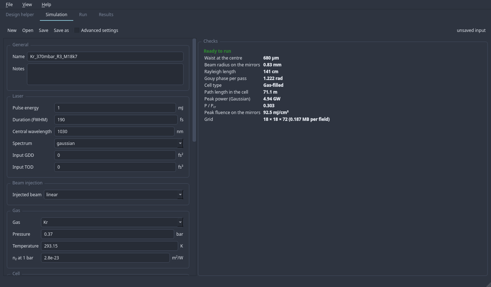
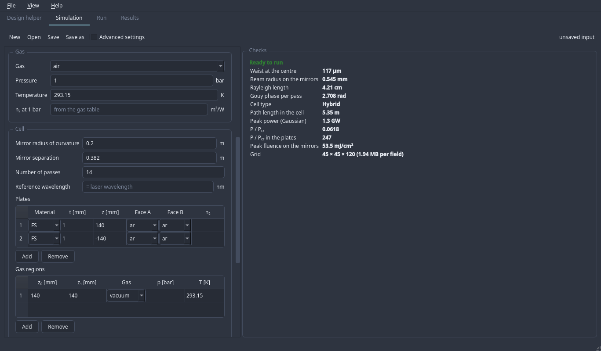
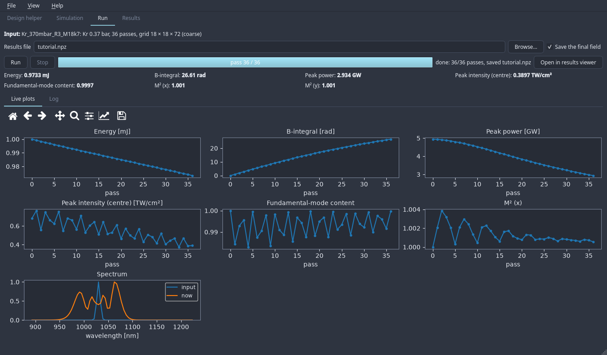
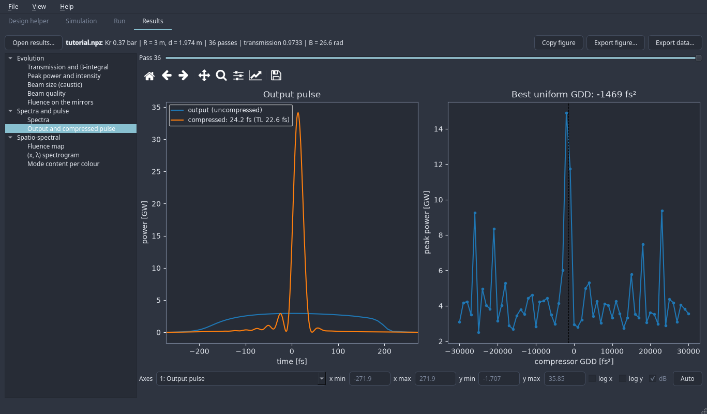

Graphical interface
===================

.. code-block:: bash

   pip install "thunder4d[gui]"
   thunder4d-gui                 # or: thunder4d-gui cell.json

Four tabs, used from left to right. Everything is saved as standard input files (``.json``) and results
(``.npz``), so a session can be rerun or analysed from a script. Hover a field or a table column to read
what it means.

Design helper
-------------

Pick a laser preset or enter the laser, set the limits and the search, then **Find designs**. The
search of the :doc:`design helper <user_guide/design>` runs in the background (Fast 1+1D, or analytic
for a first look). A progress bar and the elapsed time follow it, **Stop** ends it, and the window flashes
in the task bar when it is over. *Details* gives the report of the selected design, *Design map* the
pressure × round-trips plane around it. **Use in simulation builder** (or a double click) sends the design
to the next tab.

- **Limits and search.** Besides the laser, the gases and the mirrors, the form sets the maximum fluence on
  the mirrors (empty: the damage threshold of each coating), the coatings to try, the range of the index
  :math:`k` of the cell and the number of workers of the Fast 1+1D simulations (default: all the cores).
- **Problems.** *Open*, *Save* and *Reset* load, write and clear a design problem (``.json``). *Open* also
  reads the problem stored in a saved result.
- **Cell type.** Only the gas-filled cell has a design helper. Bulk and hybrid cells are listed, greyed
  out, until they have theirs. They can already be simulated from the next tab.
- **Table.** A click on a column sorts on it, the score is the default. *Copy table* puts the designs in the
  clipboard, ready for a spreadsheet, and *CSV…* saves them.

Simulation
----------

Every field of the input file, in readable units, checked while you type: a field at fault is framed in
red and listed under *Checks*. A valid input shows its cell type, eigenmode, peak power and :math:`P/P_{cr}`,
peak fluence on the mirrors and grid size. Tables (measured spectrum, mirror curves) are imported from CSV or
pasted from a spreadsheet, first column in nm. *Save* is disabled while the input has problems.

Bulk and hybrid cells are set in the *Cell* section. *Plates* is a table with one row per plate (material,
thickness, position along the axis, coating of each face and optional :math:`n_2`), and *Gas regions* a table
with one row per region filled with another gas. Choose ``vacuum`` as the gas for a bulk cell. *Checks* then
shows the cell type (gas-filled, bulk or hybrid) and :math:`P/P_{cr}` in the plates. The model is described in
:doc:`user_guide/bulk_hybrid`.

   The hybrid cell of Westerberg *et al.*: two 1 mm fused-silica plates and a vacuum region between them.

Run
---

Runs the input pass by pass in the background, with the progress, the time left, and the energy,
B-integral, peak power and intensity, mode content and :math:`M^2` after every pass. **Stop** ends the
run after the current pass and still saves it, so does an error. The window flashes when the run is over.
The *Log* tab can be saved or cleared.

Results
-------

Opens the run that just finished or any saved ``.npz``. The list holds the figures the run can draw:
evolution versus pass (transmission and B, peak power, beam size at the centre and on the mirrors,
beam quality, mirror fluence), spectra, the output and compressed pulse, fluence maps, :math:`(x,\lambda)`
and :math:`(\theta,\lambda)` spectrograms, mode content per colour. The slider selects the pass.

   Output of the design above: 24.2 fs, as predicted by the design helper (24.1 fs).

- **Axes.** Under the figure, choose an axes and set its limits (empty: automatic). The *log x* and *log y*
  boxes switch the scale. Plots are linear by default. *Auto* gives back the automatic limits and scale. The
  settings stay when the pass changes.
- **dB.** Colour maps of spectra (*Spectra* and the two spectrograms) are in dB. The *dB* box shows them
  linear, normalised to their maximum.
- **Output.** *Copy figure* puts the figure in the clipboard and *Export figure* writes PNG, PDF or SVG. Both
  use paper colours (white background, dark text), whatever the theme. *Export data* writes NPZ, or CSV for 1D
  data.

Look and shortcuts
------------------

- **Themes.** *View > Theme* offers Nord (default), Light, Dark and Solarized Light. The figures follow the
  theme. *View > Text size* makes the interface smaller or larger. Theme, text size, the last folder, the recent
  files and the active tab are remembered.
- **Files.** *File > Open recent* lists the last input files, design problems and results. Dropping a ``.json`` or
  ``.npz`` file on the window opens it in the right tab.
- **Mouse wheel.** Over a list or a number box, the wheel scrolls the form. Click the box first to change its value.

.. list-table::
   :header-rows: 1
   :widths: 30 70

   * - Keys
     - Action
   * - Ctrl+1 to Ctrl+4
     - go to the tab
   * - Ctrl+Enter
     - find designs
   * - Esc
     - stop the search
   * - Ctrl+O, Ctrl+S
     - open, save a design problem (in the design helper)

The screenshots are made by ``docs/gui_screenshots.py``. To add a field, a figure or a tool to the
interface, see :doc:`development`.
