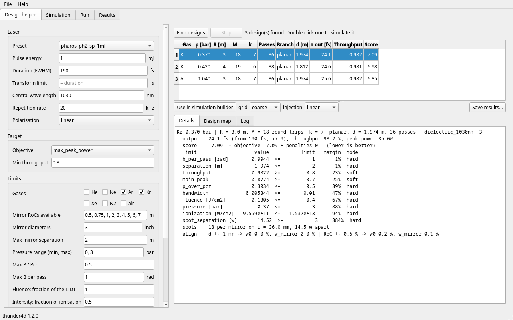
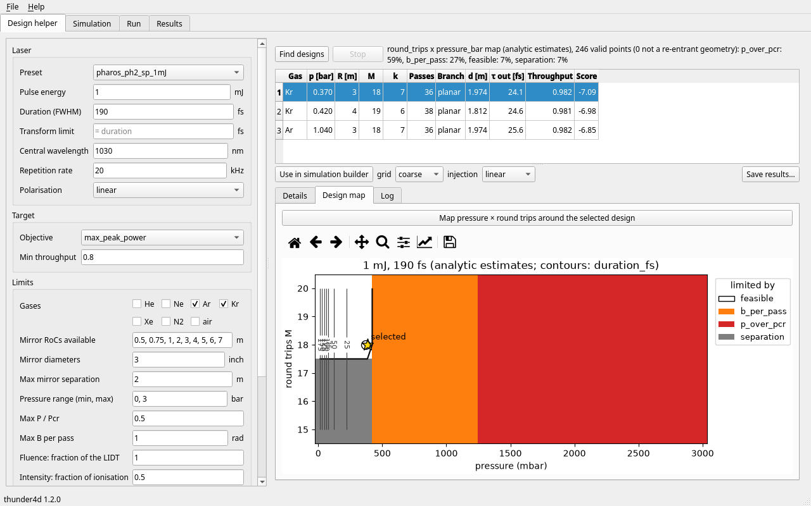
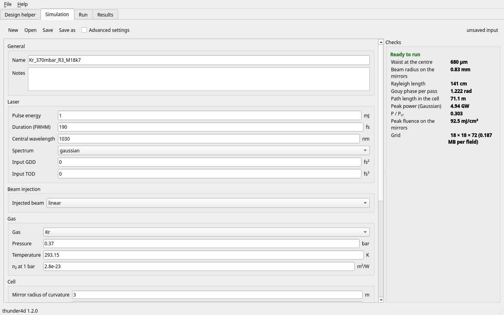
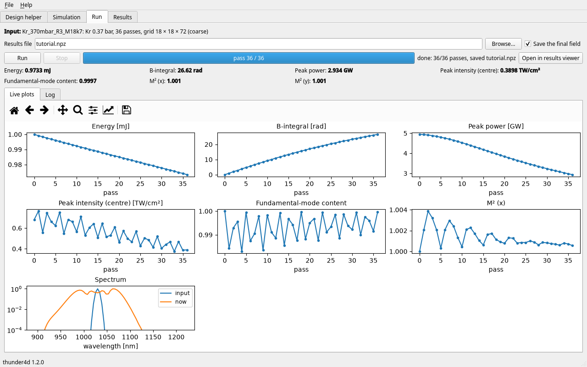
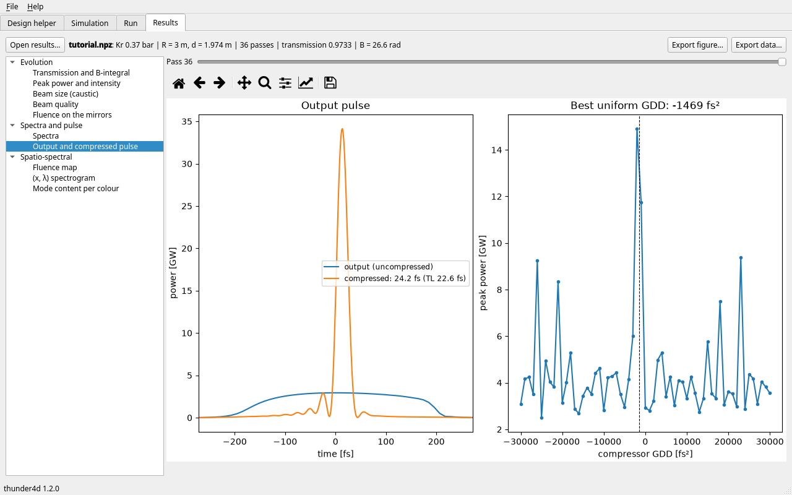
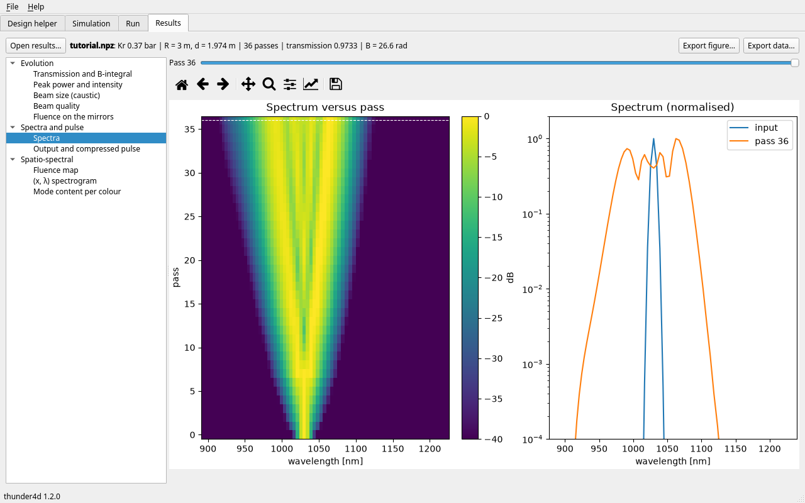

Graphical interface
===================

The graphical interface sets up, runs and inspects simulations without writing a script. Everything it
builds is a standard :doc:`input file <../api_reference/inputfile>` and every run is a standard ``.npz``
file, so anything done in the interface can be rerun or analysed from a script.

Installation and launch
-----------------------

The interface is an optional part of the package (PySide6 and matplotlib):

.. code-block:: bash

   uv add "thunder4d[gui]"            # or: pip install "thunder4d[gui]"
   uv run thunder4d-gui               # or: python -m thunder4d.gui
   uv run thunder4d-gui cell.json     # opens an input file

Without the extra, ``thunder4d-gui`` says how to install it; the solver itself never imports Qt.
The window has four tabs, used from left to right: **Design helper**, **Simulation**, **Run**,
**Results**.

Tutorial: from a laser to a compressed pulse
--------------------------------------------

This tutorial designs a cell for a 1 mJ, 190 fs Yb laser, simulates it in 4D and looks at the
compressed pulse. The screenshots are made by ``docs/gui_screenshots.py``, which runs the same steps.

1. Design the cell
~~~~~~~~~~~~~~~~~~

In **Design helper**, choose the laser preset ``pharos_ph2_sp_1mJ`` (any field can then be edited: the
preset turns to *custom*). Under *Limits*, keep argon and krypton and set the maximum mirror separation
to 2 m; under *Search*, set the round trips to ``8, 20`` and ask for 3 designs. **Find designs** runs the
search of the :doc:`design helper <../design/design>` in the background: the analytic screen, then the
refinement with the fast 1+1D solver (or the analytic estimates only, for a first look). **Stop** ends
it at the next evaluation; the *Log* tab shows its progress.

   Ranked designs. *Details* is the report of the selected one: predicted output, and the margin to
   every limit (here the B-integral per pass and the separation are the binding ones).

*Design map* draws the pressure × round-trips plane around the selected design, coloured by the limit
that binds (analytic estimates, instant). *Save results* writes the search as JSON.

   Design map around the selected design (star).

2. Check the simulation
~~~~~~~~~~~~~~~~~~~~~~~

**Use in simulation builder** (or a double click on a design) exports it as an input file, with the
chosen grid preset and beam injection, and opens the **Simulation** tab. The form shows every field of
the input file, in readable units. It is checked while you type: a field at fault is framed in red, and
the *Checks* panel lists the problems. Once the input is valid, the panel gives the linear eigenmode, the
path length, Gaussian estimates of the peak power (with :math:`P/P_{cr}`) and of the peak fluence on
the mirrors for the input pulse, and the size of the grid. *Advanced settings* shows the grid factors,
the solver and the recording options.

   The design in the simulation builder, ready to run.

Tables (measured spectrum, mirror reflectivity and GDD curves) are imported from CSV or text files
(first column: wavelength in nm) or pasted from a spreadsheet. **Save** writes the input file; it is
disabled while the input has problems. An incomplete file can still be opened, to fix it.

3. Run
~~~~~~

The **Run** tab runs the input of the builder, pass by pass, in the background. It shows the progress
and the remaining time, the last value of each followed quantity (energy, B-integral, peak power, peak
intensity at the cell centre, fundamental-mode content, :math:`M^2`) and their curves versus pass, with
the spectrum. **Stop** ends the run after the current pass and still saves what was computed. The
results file is written at the end; *Save the final field* keeps the field needed for the compressed
pulse.

   The finished run: 36 passes in krypton, B = 26.6 rad.

4. Look at the results
~~~~~~~~~~~~~~~~~~~~~~

**Results** opens the run that just finished, or any ``.npz`` saved by
:meth:`MPCSimulation.save <thunder4d.simulation.MPCSimulation.save>` (*Open results*). The list holds
the figures that this run can draw: evolution versus pass (transmission and B, peak power and
intensity, beam size at the centre and on the mirrors, beam quality, fluence on the mirrors), spectra,
output and compressed pulse, and spatio-spectral maps (fluence, :math:`(x, \lambda)` and
:math:`(\theta, \lambda)` spectrograms, mode content per colour). For the figures of one pass, the
slider selects the pass.

   Output pulse and best uniform compression: 24.2 fs, as predicted by the design helper (24.1 fs).

   Spectrum versus pass, and the spectrum of the selected pass.

**Export figure** saves the figure (PNG, PDF, SVG); **Export data** saves the arrays it shows (NPZ, or
CSV for 1D data). The matplotlib toolbar zooms and pans.

Files
-----

.. list-table::
   :header-rows: 1
   :widths: 25 75

   * - File
     - Made by / used by
   * - ``*.json`` (input)
     - Simulation tab (*Save*), design helper (*Use in simulation builder*);
       :func:`thunder4d.load_input`, :func:`thunder4d.run_input`, ``thunder4d-gui cell.json``
   * - ``*.npz`` (results)
     - Run tab; :meth:`MPCSimulation.save <thunder4d.simulation.MPCSimulation.save>`,
       ``numpy.load``, Results tab
   * - ``design.json``
     - Design helper (*Save results*): the problem and the ranked designs

.. _gui-extending:

Extending the interface
-----------------------

The interface is built from four registries, so a new feature of the solver reaches it without editing
the windows:

.. list-table::
   :header-rows: 1
   :widths: 22 30 48

   * - To show
     - Add
     - Where
   * - a new key of the input file
     - its :class:`~thunder4d.inputfile.Field` in ``FIELDS``
     - ``thunder4d/inputfile.py`` (a test fails while a key has none); the builder shows it
   * - a new kind of field
     - a ``FieldEditor`` subclass in ``EDITORS``
     - ``thunder4d/gui/fields.py``
   * - a knob of the design helper
     - its ``Field`` in ``DESIGN_FIELDS``
     - ``thunder4d/gui/panels/design.py``
   * - a quantity followed during a run
     - a ``MetricSpec`` in ``METRICS``
     - ``thunder4d/gui/metrics.py`` (the key must be in ``sim.history``)
   * - a figure of the results
     - a ``PlotSpec`` in ``PLOTS``
     - ``thunder4d/gui/plots.py``; offered for the runs that hold its ``requires`` keys
   * - a new tool
     - a ``PanelSpec`` in ``PANELS``
     - a module of ``thunder4d/gui/panels/``

For example, a figure of the Stokes parameters, offered only for runs that recorded them:

.. code-block:: python

   from thunder4d.gui.registry import PLOTS, PlotSpec

   def draw_stokes(results, fig, options):
       ax = fig.subplots()
       ax.plot(results["pass"], results["S3"] / results["S0"], ".-")
       ax.set(xlabel="pass", ylabel="S3 / S0")

   PLOTS.register(PlotSpec("stokes", "Stokes parameters", draw_stokes, requires=("pass", "S0", "S3"),
                           group="Polarisation"))

The interface holds no physics: it calls the public functions of the package
(:func:`~thunder4d.inputfile.describe_input`, :func:`~thunder4d.build_simulation`,
:mod:`~thunder4d.diagnostics`, :mod:`thunder4d.design`). A quantity that the interface needs and the
package does not provide is added to the package, with its test. Long computations run in a
``thunder4d.gui.worker.Task``: a background thread that relays what the computation prints and stops it
at the next ``task.check()``. See :doc:`../api_reference/gui`.
