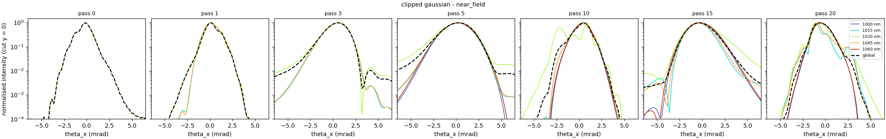

THUNDER4D
=========

**T**\ ransverse-resolved **H**\ erriott-cell **U**\ PPE solver for **N**\ onlinear **D**\ ynamics close to
**E**\ xperimental **R**\ eality, **4D**: a 4D (x, y, z, t) UPPE solver for multipass cells.

THUNDER4D simulates the nonlinear propagation of ultrashort pulses through gas-filled multipass cells
(MPCs), in 4D: the field :math:`A(x, y, t)` is propagated along :math:`z` with no symmetry assumed, so
clipped, aberrated or mismatched beams, spatial chirp and spatio-spectral homogeneity are all resolved.
A design helper proposes a cell for a given laser, and a graphical interface runs everything without
scripts.

.. code-block:: python

   import thunder4d as th

   cfg = th.default_input(
       laser={"energy_J": 1e-3, "duration_fs": 200},
       medium={"gas": "Ar", "pressure_bar": 0.7},
       cell={"roc_m": 0.6, "separation_m": 1.183, "n_passes": 26},
       grid={"lambda_min_nm": 900, "lambda_max_nm": 1180},
   )
   b = th.run_input(cfg)          # 26 passes, a few seconds on a laptop

Start with the :doc:`quickstart`. The code is checked against published experiments in the
:doc:`benchmarks <benchmarks/index>`.

   Collimated-beam profiles of a Gaussian beam clipped by a knife edge, at selected passes and
   wavelengths. The colours generated by self-phase modulation carry one to two orders of magnitude
   less edge diffraction than the fundamental.

.. toctree::
   :maxdepth: 2
   :hidden:

   quickstart
   user_guide/index
   gui
   benchmarks/index
   api_reference/api_reference
   development
