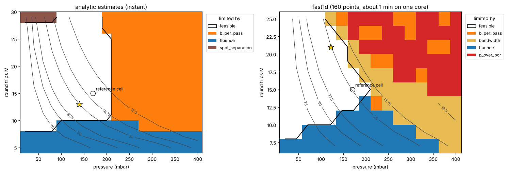
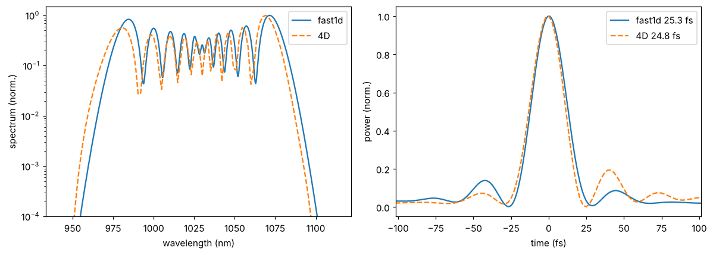

Design helper
=============

:mod:`thunder4d.design` goes from a laser and a target to ranked, ready-to-run cells: gas, pressure,
radius of curvature, round trips and passes, with the margin to every limit. It works in three layers:

.. list-table::
   :header-rows: 1
   :widths: 20 18 62

   * - Layer
     - Per cell
     - Use
   * - analytic estimates
     - microseconds
     - discard geometries, rank starting points, draw maps
   * - fast1d (1+1D)
     - 0.1–0.2 s
     - rank, tune and check the candidates
   * - thunder4d (4D)
     - seconds to minutes
     - simulate the design you keep

The notebook ``examples/design_tutorial.ipynb`` is the interactive version of this page; the
:doc:`graphical interface <../gui>` has a panel for it. The plots need matplotlib
(``thunder4d[examples]``).

Example
-------

18 mJ, 500 fs at 1030 nm, to be compressed to 25 fs in argon or krypton:

.. code-block:: python

   from thunder4d.design import DesignProblem, Fast1DQuick, LaserSpec, Max, MPCDesigner, Target, starting_points

   problem = DesignProblem(
       laser=LaserSpec(energy_J=18e-3, duration_fs=500.0, rep_rate_Hz=1e3),
       target=Target(objective="target_duration", target_duration_fs=25.0),
   )
   C = problem.constraints
   C.space.max_separation_m.value = 5.0                 # m
   C.mirrors.allowed_roc_m = (1.0, 2.0, 3.0)            # the mirrors you can use
   C.mirrors.fluence.value = 0.7                        # J/cm² (None: LIDT of the coating)
   C.kerr.b_per_pass_rad.value = 3.0                    # rad, on axis
   C.ionization.peak_intensity_W_cm2 = Max(3.5e13)      # W/cm²
   C.gas.allowed = ("Ar", "Kr")
   problem.search.round_trips = (8, 25)
   problem.search.branches = ("concentric",)
   problem.refinement.n_candidates = 3

   if __name__ == "__main__":                           # needed on Windows with workers > 1
       result = MPCDesigner(problem, quick=Fast1DQuick(), workers=4).refine(starting_points(problem))
       print(result.table())
       print(result.best.report(problem))
       result.export("design.json")                     # standard input file

.. include:: example_output.txt

The best design is argon at 170 mbar, :math:`R = 2` m, 15 round trips, :math:`k = 2`, 29 passes. Its
only violated limit is soft: 63 % of the energy in the main peak for a floor of 70 %, the pedestal of a
broad spectrum compressed with GDD only. The report lists the limits from the tightest to the loosest:
the first line is what constrains the design.

The problem
-----------

:class:`~thunder4d.design.specs.DesignProblem` has seven blocks, all dataclasses with defaults; set only
what matters.

.. list-table::
   :header-rows: 1
   :widths: 18 82

   * - Block
     - Content
   * - ``laser``
     - energy, duration, wavelength, transform limit if chirped, shape, pre-chirp, repetition rate,
       polarisation. ``LaserSpec.preset("pharos_ph2_sp_2mJ", rep_rate_Hz=1e3)`` takes a datasheet.
   * - ``target``
     - ``objective``: ``"max_peak_power"`` (default), ``"shortest"``, ``"target_duration"``,
       ``"target_compression"`` or ``"weighted"``; soft floors ``min_throughput`` (0.8) and
       ``min_main_peak_fraction`` (0.7)
   * - ``constraints``
     - space (``max_separation_m`` 4 m), mirrors (radii, diameters, coatings, ``fluence``,
       ``bandwidth``), Kerr (``p_over_pcr`` 0.5, ``b_per_pass_rad`` 1 rad), ionisation, spot pattern
       (spots 3 radii apart, 2.5 radii from the edge), pressure range (0–3 bar) and resolution, gases
   * - ``losses``
     - ``mode_matching_efficiency``
   * - ``search``
     - which geometries are tried: gases, radii, branches, round trips :math:`M` (3–40), :math:`k`,
       passes per geometry
   * - ``refinement``
     - how many designs (5), what is tuned (pressure, optionally the pre-chirp), neighbours tried
   * - ``tolerance``
     - alignment errors whose effect each report gives (information only)

A Herriott geometry is :math:`(R, M, k)`, with :math:`d = R\,(1 \pm \cos(\pi k/M))` (``+``: concentric).
One cycle is :math:`2M` passes with :math:`M` spots per mirror; the passes used can be fewer.

**Limits.** Every constraint is a :class:`~thunder4d.design.specs.Limit`, built with ``Max(...)``,
``Min(...)`` or ``Off()``. ``mode="hard"`` rejects a design that violates it, ``"soft"`` adds
``weight * margin**2`` to the score. ``value=None`` takes the value from the catalogue (LIDT of the
coating at the pulse duration of each bounce, ionisation threshold of the gas). The limit applied is
``value * safety`` for a maximum.

.. warning::

   Setting only ``.value`` keeps the ``safety`` in place: the ionisation limit has ``safety = 0.5``, so
   ``peak_intensity_W_cm2.value = 3.5e13`` applies 1.75e13 W/cm². Replace the whole limit
   (``Max(3.5e13)``) to reset it.

**Catalogues.** The gases take their dispersion and :math:`n_2` from :mod:`thunder4d.materials` and add
an ionisation threshold, by default 0.2 times the barrier-suppression intensity: an order of magnitude,
**set your own**. The mirror catalogue has three coatings (``dielectric_1030nm``, ``dielectric_800nm``,
``enhanced_silver``); add yours:

.. code-block:: python

   from thunder4d.design.catalog import GASES, Coating, register_mirror

   GASES["Ar"] = GASES["Ar"].with_(ionization_threshold_W_cm2=4e13)
   register_mirror(Coating.from_files("my_hr", "R.csv", "GDD.csv", delimiter=",",   # columns: nm, value
                                      lidt_J_cm2=0.7, band_nm=(950.0, 1110.0)))

The search
----------

.. code-block:: text

   starting_points()  ->  screen()  ->  refine()
   enumerate and          rank with the       run the quick solver, tune the
   prefilter              analytic estimates  best candidates, return n designs

- ``starting_points`` enumerates the allowed geometries and drops those that a hard limit already
  excludes analytically (separation, fluence, ionisation, spot pattern). It never drops a cell that
  could pass. Each one starts at an analytic guess of the pressure.
- ``screen`` ranks them with the analytic estimates and keeps the best, spread over gases, radii and
  branches. ``refine`` runs the quick solver on them, tries their neighbours (more or fewer passes,
  next radius), optimises the pressure and rounds it to your regulator.
- The score is the objective plus the penalties of the soft limits; a violated hard limit makes it
  infinite. Ask for several designs: the first ranking uses the untuned pressure.
- ``MPCDesigner(..., workers=N)`` runs the quick solver in N processes.

Quick solvers
-------------

A quick solver is any callable ``quick(problem, candidate) -> QuickResult``; only the duration, the
peak power and the throughput are required, every other field is checked against its limit.

- :class:`~thunder4d.design.scan.AnalyticQuick`: closed forms, no dispersion. Its durations are
  optimistic: use it to explore, not to decide.
- :class:`~thunder4d.design.fast1d_quick.Fast1DQuick`: a time envelope with the full dispersion of the
  gas, coupled to a Gaussian beam followed through its :math:`q` parameter (thin Kerr lens at each
  step), with the mirror curves of the coating at each bounce. ``accuracy="fast"`` (0.1–0.2 s) is
  within 0.4 % of ``"fine"`` (2–8 s). It stops on beam collapse, optical shock or runaway step counts,
  and the cell is then rejected.

fast1d is least reliable when :math:`P/P_c` is not small (its Gaussian ansatz is the weak point), for
very broad spectra, and for non-Gaussian, clipped or mismatched beams. Treat its durations as good to a
few percent on moderate cells and about 10 % on strongly nonlinear ones.
``Fast1DQuick().validate(problem, design)`` checks that it is converged for a design.

Maps
----

A map shows, for two parameters, where a cell is feasible and, where it is not, **which limit excludes
it**: the fastest way to see what limits a design.

.. code-block:: python

   import numpy as np
   from thunder4d.design import design_map

   m = design_map(problem, gas="Ar", roc_m=2.0, k=2)                    # pressure × round trips, analytic
   m.plot(mark=[(0.17, 15, "reference cell")])
   m = design_map(problem, gas="Ar", roc_m=2.0, k=2, quick=Fast1DQuick(), workers=8)
   design_map(problem, gas="Ar", roc_m=2.0, k=2, round_trips=15,
              x=("energy_J", np.linspace(5e-3, 30e-3, 12)), y=("pressure_bar", np.linspace(0.05, 0.3, 12)))

Axes: ``pressure_bar``, ``round_trips``, ``n_passes``, ``roc_m``, ``k``, ``energy_J``, ``duration_fs``.
The result keeps the limiting constraint, the tightest margin and the metrics at every point.

   Argon, :math:`R = 2` m, :math:`k = 2`. Left: analytic (0.3 s). Right: fast1d (160 points, one
   minute). White is feasible; each colour is the limit that excludes the region; grey lines are the
   compressed duration in fs.

From a design to the 4D solver
------------------------------

A design is exported as a standard input file and runs with nothing from the helper:

.. code-block:: python

   import thunder4d as th

   result.export("design.json", preset="medium")      # or to_input(problem, candidate) for a dict
   b = th.run_input("design.json")

``preset`` sets the grid (``"coarse"``: seconds to minutes, ``"medium"``, ``"fine"``: benchmark grade),
``injection`` the beam (linear or Kerr-matched eigenmode), and the spectral window follows the
predicted spectrum. The file records the predictions and margins in its ``design`` block.

``validate_4d(problem, design)`` runs fast1d and the 4D solver on the same cell and compares them. On
the example design, coarse grid, 9 s:

.. code-block:: text

     quantity                        fast1d          4D     diff
     transmission                    0.9856      0.9757    -1.0%
     B-integral [rad]                 63.23       67.95    +7.5%
     compressed duration [fs]         25.34       24.79    -2.2%
     compressed peak [GW]             435.3         403    -7.4%
     mirror fluence [J/cm2]          0.5587      0.5139    -8.0%
     M2 (x, mean)                                 1.002

   Output spectrum and compressed pulse of both solvers on the example design.

The durations and the transmission agree within a few percent. At :math:`P/P_c = 0.34` the beam is no
longer a perfect Gaussian, so the 4D B-integral is higher and the peak power and fluence lower: when a
margin matters, use the 4D numbers.

**Workflow.** Search with fast1d and keep three to five designs; check fast1d's convergence on each;
``validate_4d`` each; export the one you build at ``"medium"`` or ``"fine"``, edit the file (measured
spectrum, injection) and run it.

**Scope.** One stage, an ideal GDD compressor, a Gaussian beam, no Raman (N₂ and air are flagged), no
ionisation loss (the intensity is limited, not simulated). The margins are only as good as the
thresholds you give.
